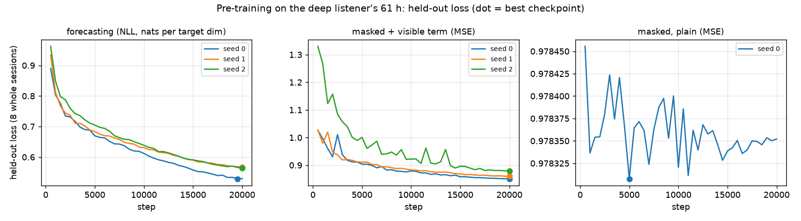
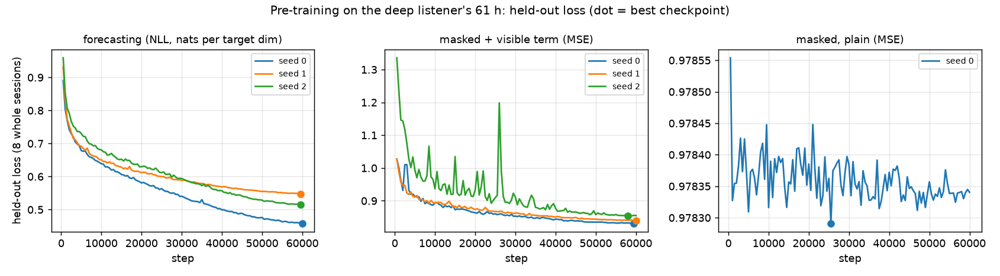

# NeuroCast

**Forecasting the brain as a foundation for decoding it.**

A stimulus-conditioned, subject-in-context predictive model of brain dynamics —
built so that the same artifact serves as a pretraining objective, a measurement
instrument, and the forward model of a decoder.

---

## 1. The idea in one page

Non-invasive brain decoding is stuck on one problem and quietly compromised by a
second.

**Stuck.** Decoders work *within* a subject and collapse *across* subjects. On
identical 50-word decoding from MEG, a within-subject supervised model reaches
**73.23% BAcc@10** while the best cross-subject self-supervised model reaches
**42.96%**. Every brain foundation model retrains or fine-tunes per subject.

**Compromised.** A wave of 2026 audits shows much of the reported progress is
shortcut learning:

- *The Identity Trap* ([arXiv 2606.06647]) — frozen subject-identity variance is
  **13–89× a random null in 12/12 model-dataset pairs**, and fine-tuning makes it
  **worse (+10 to +63pp)**. Removing the aperiodic 1/f component drops the
  subject probe by 9–19pp: 1/f is a subject fingerprint.
- Brain-to-language retrieval — signal-blind **Gaussian noise scores 66.3%
  Rank@1** under the field's standard variable-length protocol
  ([arXiv 2605.24524]).
- MOABB's large reproducibility study — deep learning still hasn't clearly beaten
  2010s Riemannian methods ([arXiv 2404.15319]).

**The bet.** Both problems have one cause: the field trains **classifiers**, and
a classifier is free to solve its task however it can. Identity is the cheapest
shortcut available. Train a **forecaster** instead — a model of *what this brain
will do next* — and the shortcut stops paying, because the target changes every
millisecond and depends on the stimulus.

This is not a hunch. The Sept-2026 *Roadmap for MEG Foundation Models*
([arXiv 2609.04461], v2) says of pretraining objectives, for EEG and MEG alike,
that **"the decisive comparison at matched data, compute and architecture is
still missing"** (§V-B). It lists latent-space masked reconstruction (JEPA) among
the objective classes that **"still have no MEG instance"** (§III-D). And it
says **"scaling law analyses across compute, model and data size are yet to be
conducted for MEG"** (§V-E). (An earlier version of this README paraphrased the
last two as "completely unexplored" and "not yet done"; the wording above is
the paper's.)

### Falsifiable claims

| | Claim | Kill condition |
|---|---|---|
| **H1** | At matched data/compute/architecture, forecasting transfers better than masked reconstruction | masking wins or ties on both axes across ≥2 of 3 compute tiers, 3 seeds |
| **H2** | Forecasting starves the identity shortcut — lower FMScope subject-variance than masked models | forecasting arms leak as much as masked arms — **met**: forecasting leaks 6–8× *more* after single-listener pre-training (§2.2, LibriBrain; still 3–5× more after three times the training) and 8–11× more about *unseen* people after 20-listener pre-training (§2.3, MEG-MASC), 3 seeds each |
| **H3** | The subject is a *prompt*, not a fine-tune: K minutes in-context ≥ fine-tuning on the same K minutes | prompting underperforms LoRA by >3pp BAcc@10 at K ∈ {10,20,40} min |
| **H4** | The forecaster inverts into a decoder via noisy-channel inference with an LLM prior | see §13 — R1 is measured, and two of the design's three mitigations failed |
| **H5** | Geometry conditioning transfers MEG→EEG/OPM/iEEG without retraining | training from scratch on the target array matches or beats zero-shot transfer (the Phase-3 gate; rehearsal in §16) |

Plus one deliverable that is **architecture-independent and survives all five
failing**: the **Neural Predictability Atlas** — how many bits of a human brain's
future are knowable, by horizon, band, region, and conditioning set. The
information-theoretic framework exists ([arXiv 2603.27074]) and has never been
applied to human M/EEG. Its estimators are built and validated against analytic
answers (§14).

**Mechanism for H2.** A subject's nuisance structure — 1/f slope, head position,
sensor coupling — is *visible in the context window*. A model that can read it
from the prompt has no incentive to store it in weights. And the corpus is too
small to memorise 800 subjects anyway (§7).

---

## 2. Status

**Phase 0 is built and validated against ground truth, on synthetic data**, and
the lost version's real-data audit has been re-run on LibriBrain100 (§2.1). The
rule held throughout: the leakage harness shipped before anything it might have
to audit. Every module below has a script that constructs a case with a known
answer, including cases that *are* leaky, and asserts the code reaches it. A
guard that never fires is not a guard.

| Module | What it is | Validated by |
|---|---|---|
| `audit/surrogates.py`, `audit/controls.py` | null-control suite: surrogates, permutation null, pass/fail table | `validate_controls.py` |
| `audit/fmscope.py` | subject-identity leakage (the H2 metric) | `run_bakeoff.py` |
| `data/canonical.py` | INV-1: frozen observation space, `log\|det J\|` bookkeeping | `validate_canonical.py` |
| `data/splits.py` | temporal / subject / stimulus disjointness, fingerprints | `validate_splits.py` |
| `data/paths.py` | where data lives: absolute, on the right disk, caches off C: | `validate_paths.py`, `data_setup.py check` |
| `data/synthetic.py` | identity-strong, label-weak corpus with known answer | `run_bakeoff.py` |
| `data/sources.py` | source-space corpus: one brain, any sensor array | `validate_generative.py`, `run_transfer.py` |
| `tokenizer/` | montage-agnostic front-end, exact AR factorisation | `validate_tokenizer.py` |
| `models/backbone.py`, `models/heads.py` | causal stack; mixture density + arm heads | `validate_backbone.py` |
| `models/conditioning.py` | subject prompt encoder; banded stimulus cross-attention | `validate_conditioning.py` |
| `models/neurocast.py` | the assembled model; input masking for the masked arms | `validate_backbone.py` section 8 |
| `models/forecast.py` | autoregressive rollout, group by group | `validate_generative.py` |
| `objectives/arms.py` | the five bake-off arms | `validate_backbone.py` |
| `train/flops.py` | measured FLOP accounting, HPO charged per arm | `validate_flops.py` |
| `train/loop.py` | bake-off loop under a measured budget | `validate_backbone.py` section 8, `run_bakeoff.py` |
| `train/targets.py`, `train/generative.py` | invertible quadrant-PCA targets; flagship trainer | `validate_generative.py` |
| `adapt/episodes.py`, `adapt/nuisance.py` | episodic sampler, guard bands; 1/f + band-power descriptors | `validate_adapt.py` |
| `decode/metrics.py`, `decode/scorer.py` | BAcc@k; noisy-channel scorer, λ calibration | `validate_decode.py` |
| `atlas/estimators.py`, `atlas/filters.py`, `atlas/stats.py` | forecastability estimators, causal filters, dependent-data inference | `validate_atlas.py` |
| `eval/references.py` | INV-1's reference rows: PSD-matched null, AR(16), white | `validate_eval.py` |
| `eval/yardstick.py` | step 1's yardstick (speech, phoneme and voicing labels from the events, lagged features, a deterministic linear probe, macro-F1/BAcc/AUC) and step 2's descriptor regression | `validate_libribrain.py` §13, `run_bakeoff_real.py` |
| `viz/topomap.py` | topographic maps; the real-vs-forecast movie | `validate_viz.py`, `run_demo.py` |
| `data/libribrain.py`, `data/megin.py` | LibriBrain runs (incl. the partial releases pnpl misses), windows; real 306-sensor geometry | `validate_libribrain.py` |
| `data/megmasc.py` | MEG-MASC word events in the same word table; KIT recordings filtered, resampled, cached; a KIT montage in head coordinates from the digitised head positions | `validate_libribrain.py` §10, `run_megmasc_*.py` |
| `decode/words.py`, `decode/baselines.py`, `decode/decoders.py`, `decode/covariates.py` | 50-word task, no-brain baselines (timing, and stimulus-only rungs with envelope and band levels from the audio, §2.4), the pitch's four brain decoders plus EEGNet and a subject CNN, word loudness | `validate_libribrain.py`, `run_libribrain_audit.py` |
| `audit/fake_signals.py`, `audit/timing_matched.py`, `audit/collapse.py` | onset-only control; timing-matched test; nats beyond covariates; masked-collapse diagnostic | `validate_libribrain.py`; collapse: `validate_pretrain.py` |
| `train/pretrain.py` | real-data pre-training: warm-up + cosine, mixed precision, bit-exact resume | `validate_pretrain.py`, `run_pretrain_pilot.py` |

### Not built yet

Stated plainly, so nobody reads the table above as more than it is:

- **A general real-data loader.** LibriBrain's word windows, canonical arrays and
  real sensor geometry exist (`data/libribrain.py`, `data/megin.py`) and the
  audit runs on them, but recordings are not yet expressed as `Segment`s that
  `splits.py` guards, and no other corpus is wired in.
- **The Phase-2 trainer.** `EpisodeSampler` and `PromptEncoder` are each built and
  validated, but no training loop joins them to the backbone, and the H3
  comparators (embedding / LoRA / full fine-tune at matched minutes) do not exist.
- **The decoder on a trained forecaster.** `decode/` is validated on synthetic
  Gaussian class likelihoods; it has not been fed a NeuroCast likelihood or a real
  language model.
- **MEG-XL reproduction** and FMScope on its checkpoint.
- **Mamba-2 blocks** — `SSMBlock` is an interface stub (§17).
- **The Atlas production run** — the estimators are validated; no pipeline runs
  them over recordings by horizon, band and region.

### 2.1 Real data — the lost version, re-verified

An earlier, further-along NeuroCast was lost after 29 September 2026. Its faculty
pitch ([`docs/recovered/neurocast-pitch.html`](docs/recovered/neurocast-pitch.html))
is the only record, quoting real-data results from a README section that no
longer exists. Every checkable number in it was re-measured with this code on
freshly downloaded LibriBrain100. Claims were never edited to fit; the full
ledger — each claim, the re-measured value, a verdict — is
[`docs/recovered/VERIFICATION.md`](docs/recovered/VERIFICATION.md).

50 words, 32 listeners, fit chapter 11, test chapter 12 (32,198 / 32,251
MEG-covered trials — the pitch's counts exactly). BAcc@1 / BAcc@10, chance
0.02 / 0.20.

| | Pitch | Re-measured | |
|---|---|---|---|
| speech timing only — **no brain data** | 0.15–0.18 / 0.61–0.67 | 0.166 / 0.666 | ✅ |
| language model + timing — no brain data | ~0.35 / 0.80 | 0.372 / 0.818 | ✅ |
| linear decoder | 0.027 / 0.257 | 0.031 / 0.259 | ≈ |
| linear, one per person | 0.028 / 0.245 | 0.027 / 0.245 | ✅ |
| MLP | 0.036 / 0.278 | 0.034 / 0.268 | ≈ |
| CNN on the raw 125 Hz signal | 0.044 / 0.298 | 0.042 / 0.301 | ✅ |
| onset-only fake signal: share of the linear gain | 21–53% | 28% | ✅ |
| linear gain surviving the timing-matched test | about half | 52% (timing-only scorer: 21%) | ✅ |
| word information beyond timing, length, loudness: CNN / linear | 5× | 4.1× | ≈ |
| … the best decoder, nats per word | ~0.01 | 0.031 (CNN) | ❌ higher |
| phase-scrambled input | near chance (~0.217) | 0.236 as first run; 0.201 once each window's mean is removed too | ✅ after the fix |
| … each window's mean alone (constant in time) | — | 0.240 — **67% of the linear gain** | new |
| person information, raw signal (identity audit, word windows) | 3× | 1.8× (64 ms patch means, N = 8,000) | ❌ |

Pre-training pilot (§6 of the ledger): 6m rung (24.9M), the deep listener's 47.5 min, 4,000 steps per arm at 0.21–0.25 s/step on the RTX 3050.

| | Pitch | Re-measured | |
|---|---|---|---|
| masked model collapsed on real data | output ignored input | spread 0.000, sensitivity to context 0.000 | ✅ |
| … also at a lower learning rate | still collapsed | lr 3e-4: collapsed | ✅ |
| … fixed by scoring visible positions | fixed | sensitivity 0.95, R² +0.069 | ✅ |
| frozen features decode about equally well | yes | forecasting 0.243, fixed masked 0.242 BAcc@10 (raw-signal linear: 0.259) | ✅ |
| person information, forecasting vs masked | 29× vs 10× (≈3×) | 11.8× vs 4.9× (2.4×) at N = 2,048 windows | ≈ |
| … raw signal | 3× | 32.9× (log amplitude, same windows) | ❌ |
| linear recovery of a hidden patch from its neighbours | 34–48% | 14% (one patch hidden) | ❌ |

**What held.** The pitch's central finding reproduces: speech timing alone, with
no brain data, puts the heard word in the top ten two-thirds of the time — more
than any brain decoder here — and about half of a brain decoder's gain survives
matching trials on timing, length and loudness, with stronger decoders finding
more. The brain signal is real, and small. (§2.4 later showed that the matching
does not remove acoustic information, and that against a model of the window's
coarse acoustics the decoders add at most 0.006 nats/word.)

**What did not.** Several numbers are off; each has a recorded reason or is an
open question. The first phase-scrambled control kept every window's mean,
and that mean alone carries two thirds of the linear decoder's gain. Removed, the
control falls to chance, as the pitch said. The CNN's information beyond
timing, length and loudness is about 3× the pitch's ~0.01 nats, though the
CNN-to-linear ratio (4.1×) is close to its 5×. The identity ratios are
smaller than the pitch's, and they cannot be compared without its sample
size (the ratio is capped at (N − 1)/(S − 1), §9). What does compare is that
forecasting carries more person information than fixed masked pre-training,
2.4× here and ~3× in the pitch — the unexpected direction the pitch reported,
reproduced. No raw-signal feature gives the pitch's 3×. A linear predictor
recovers 14% of an isolated hidden patch, not 34–48%. Predictability (ledger §5)
matches in shape but not at 4 ms or in gamma.

**Under the competition's own protocol** (ledger §4b). pnpl's loader for the
2026 holdout confirms that its sentence test data ships every word's onset, and
that words are scored from 1.0 s windows over a fixed 50-word list. Re-run that
way (1.024 s windows, the competition's words), speech timing alone puts the
heard word in the top ten 0.69 of the time (0.70 on the 44 words both chapters
contain), while no brain decoder here reaches 0.27. None of them adds detectable
information beyond timing, length and loudness. The decoders were not re-tuned
for the longer window, and the competition's test stimuli are probably not these
chapters.

The organisers' own papers report no such row. The 2026 competition paper
([arXiv 2609.03231]) gives reference decoders at 0.732 BAcc@10 (deep track,
d'Ascoli) and 0.430 (broad track, MEG-XL), against 0.20 chance. The LibriBrain100
paper ([arXiv 2608.25204]) "made a deliberate decision not to include a
brain-to-text baseline". Neither reports a timing, stimulus-only or shuffled
baseline. Timing alone at 0.69 is not directly comparable (different test
stimuli and windows), but it says a no-brain row belongs beside those numbers.
§2.4 adds that a no-brain model hearing only the window's broadband envelope
reaches 0.81 under the same protocol.
Submissions close on 15 October 2026 and top entries are verified until
30 November, so this goes to the organisers privately first, as the pitch
planned.

**On a second dataset** (ledger §4c). In MEG-MASC's synthesised stories, timing
alone scores 0.095 / 0.416 on held-out stories (shuffled-label p95 0.226). The
confound replicates, though weaker than on LibriBrain even at matched training
size (0.549). The brain half, all 27 listeners: a linear decoder at
0.031 / 0.231, adding +0.0035 nats/word beyond timing, length and loudness, about
half of LibriBrain's. (MEG-MASC's short stories leave the timing-matched test
too few words per stratum to read.) Only the word events are needed:
`data_setup.py fetch-osf --include "*_events.tsv"` (0.6 GB of MEG-MASC's
100 GB).

Re-run (data: the 32 broad listeners' chapters 11–12 and the deep listener's
Sherlock sessions, §5.1; ~18 GB):

```powershell
.venv\Scripts\python.exe scripts\run_libribrain_audit.py --stage nobrain
.venv\Scripts\python.exe scripts\run_libribrain_audit.py --stage brain
.venv\Scripts\python.exe scripts\run_libribrain_audit.py --stage matched
.venv\Scripts\python.exe scripts\run_phase_control.py
```

The pilot needs the CUDA build of torch (here a separate `.venv-gpu`) and ~1 h
of GPU for three arms; the evaluation reads every listener once (~25 min from a
USB disk). The ledger lists the commands.

### 2.2 Forecasting vs masked at scale — rules fixed before the run

*Written 8 October 2026, before any of these runs had finished.* The pilot
trained on 38 minutes and its forecasting arm overfit by step 2,000, so its
identity and decoding numbers come from one seed of an overfit model. This is
the comparison the pitch planned next (`scripts/run_pretrain_scale.py`):

- **Data.** Every Sherlock session of the deep listener (sub-0) that the word
  probe does not use: 112 sessions, ~60 h (from Sherlock3 on, sessions run about an
  hour each). Sherlock1 sessions 11–12 (the probe's
  chapters) are excluded. The last session of each of Sherlock2–9 is held out
  whole (8 sessions) for loss tracking.
- **Arms.** Likelihood forecasting and masked reconstruction with the
  visible-position term, 3 seeds each. Plain masked, 1 seed, to see whether the
  collapse survives ~90× more data.
- **Recipe.** The pilot's (6m rung, 24.9M parameters, 4-s windows, batch 8,
  AdamW 1e-3, warm-up and cosine), 20,000 steps; the checkpoint with the best
  held-out loss is the one evaluated.
- **Measurements.** The masked-collapse diagnostic; the identity audit (32
  broad listeners, 64 windows each, N = 2,048, ceiling 66×); the frozen-feature
  word probe (fit chapter 11, test chapter 12).

Decision rules:

| Question | Verdict |
|---|---|
| Does forecasting leak more person information? (H2, the pilot said 2.4× more) | "more" if its identity ratio is above fixed masked's for all 3 seeds; "less" if below for all 3; otherwise "no consistent difference" |
| Do frozen features decode equally well? (the pitch: "about equally") | "equal" if the mean BAcc@10 differs by less than 0.01; otherwise the higher arm, if all 3 seeds agree |
| Does plain masked still collapse on ~60 h? | the diagnostic's rule: spread or context sensitivity below 0.05 |
| Was a run long enough? | its best held-out loss came before its last evaluation; if not, it is reported as under-trained |

**Results** (9 October 2026; `runs/pretrain_scale/scale_eval.json`, from
`run_pretrain_scale.py --evaluate`, which applies the rules above itself).
Training data: 61.3 h, with 5.9 h held out in 8 whole sessions. Six runs at
0.29–0.32 s/step on the RTX 3050.

| | Forecasting (3 seeds) | Masked + visible term (3 seeds) |
|---|---|---|
| person information: identity ratio, N = 2,048, ceiling 66× | **33.2 ± 2.1×** (31.4, 32.8, 35.5) | **4.8 ± 0.3×** (4.5, 5.0, 5.0) |
| … subject probe on the same features (chance 0.031) | 0.86–0.91 | 0.20–0.23 |
| frozen-feature word probe, BAcc@1 / BAcc@10 | 0.028 / 0.245 ± 0.007 | 0.028 / 0.246 ± 0.003 |
| collapse diagnostic (masked) | — | all three read their input (sensitivity 0.99–1.05, hidden-patch R² 0.12–0.20) |
| best held-out loss (not comparable across seeds or arms) | 0.529, 0.567, 0.564 | 0.851, 0.860, 0.879 |

Plain masked (1 seed): **collapsed** (spread 0.000, sensitivity 0.000), identity
13.9×, word probe 0.019 / 0.197, chance. Its outputs ignore their input, but its
pooled features still vary by person.

Raw signal on the same windows (per-channel log amplitude): 32.9×, subject probe 0.86.

| Question | Verdict under the rule |
|---|---|
| Does forecasting leak more person information? | **more**: 6.6×, 6.3×, 7.9× fixed masked's ratio, seed by seed |
| Do frozen features decode equally well? | **equal**: mean BAcc@10 difference −0.001 |
| Were the runs long enough? | **no**: 5 of 6 had their best held-out loss at the last evaluation (forecasting seed 0 one evaluation earlier); both objectives were still improving at 20,000 steps (figure) |
| Does plain masked still collapse on ~60 h? | **yes**: spread 0.000 and context sensitivity 0.000 at steps 2,000, 10,000 and on the best checkpoint; held-out loss flat at 0.978 for all 20,000 steps |



**What it means.** The pilot's surprise holds at ~90× the data and three seeds,
and grows. Forecasting features carry about as much person information as the
raw signal itself (33× against 32.9×; a probe names the listener 86–91% of the
time). Fixed-masked features keep a seventh of it. Both decode words equally
badly, below a linear decoder on the raw signal (0.259). For this
configuration, **H2's kill condition is met**: the forecasting arm leaks *more*
person information than the masked arm, not less. The configuration is the 6m
rung, one listener's data, frozen pooled features, runs still improving at
20,000 steps. Two things it does not settle: whether longer training changes the
gap, and whether pre-training on many listeners (where person information has
to be modelled rather than memorised) reverses it. The second is the setting H2
was written for. (Both have since been tested: the gap holds at three times the
training, below, and widens across 20 listeners, §2.3.) Each seed fits its own
target basis on 64 random windows, so held-out losses compare only within a
seed; that is also why seed 2's masked curve sits apart.

**Longer training — rules fixed before the run** (*written 9 October 2026,
before it started*). The same comparison at 60,000 steps (3×, a full cosine
schedule, not a resumed one), in `runs/pretrain_scale_60k/` (`chain.cmd` runs it
and evaluates after each seed pair). The decision rules above apply unchanged.
In addition: the gap "holds" if forecasting's identity ratio is still above
masked's for every seed, and "closes" if not. Decoding "improves with training"
for an arm if its mean BAcc@10 rises by at least 0.01 over its 20,000-step value.

**Results** (13 October 2026; `runs/pretrain_scale_60k/scale_eval.json`). Seven
runs at 0.26–0.37 s/step, except one stretch. Late in forecasting seed 1 the
steps slowed to 0.50 s, and masked seed 1 then ran at ~3.2 s/step for 33 h until
the data drive dropped out. It resumed from its step-37,500 checkpoint at
normal speed (§9). A seed keeps its target basis at any run length
(it is fitted on 64 windows drawn from the seed), so held-out losses compare
between the two lengths seed by seed.

| | Forecasting (3 seeds) | Masked + visible term (3 seeds) |
|---|---|---|
| person information: identity ratio, N = 2,048, ceiling 66× | **39.1 ± 2.4×** (41.3, 36.6, 39.5) | **9.2 ± 2.3×** (8.8, 11.7, 7.2) |
| … at 20,000 steps | 33.2 ± 2.1× | 4.8 ± 0.3× |
| … subject probe on the same features (chance 0.031) | 0.93–0.96 | 0.24–0.32 |
| frozen-feature word probe, BAcc@1 / BAcc@10 | 0.026 / 0.239 ± 0.008 | 0.028 / 0.245 ± 0.006 |
| … at 20,000 steps | 0.028 / 0.245 ± 0.007 | 0.028 / 0.246 ± 0.003 |
| best held-out loss, seeds 0 / 1 / 2, 20,000 → 60,000 steps | 0.529 → 0.459, 0.567 → 0.548, 0.564 → 0.515 | 0.851 → 0.832, 0.860 → 0.840, 0.879 → 0.854 |
| collapse diagnostic (masked) | — | all three read their input (sensitivity 0.98–1.10, hidden-patch R² 0.14–0.22) |

Plain masked (1 seed): still **collapsed** (spread 0.000, sensitivity 0.000);
held-out loss stayed within 0.97829–0.97856 for all 60,000 steps. Identity
14.0×, word probe 0.020 / 0.214. Raw signal on the same windows: 32.9×, subject
probe 0.86.

| Question | Verdict under the rule |
|---|---|
| Does forecasting leak more person information? | **more**: 4.7×, 3.1×, 5.5× masked's ratio, seed by seed (6.6×, 6.3×, 7.9× at 20,000 steps) |
| Does the gap hold with longer training? | **holds**: forecasting is above masked in every seed |
| Do frozen features decode equally well? | **equal**: mean BAcc@10 difference −0.006 |
| Does decoding improve with training? | **no**, for either arm: forecasting −0.006, masked −0.001 against their 20,000-step means |
| Does plain masked still collapse? | **yes**: spread and context sensitivity 0.000; held-out loss flat |
| Were the runs long enough? | 2 of 6 are under-trained by the rule (forecasting seed 0, masked seed 1), but their last 2,000 steps improved held-out loss by only 0.0015 and 0.0009; the other four peaked at steps 58,000–59,500. At 20,000 steps, 5 of 6 were under-trained |



**What it means.** Three times the training lowers both objectives' held-out
loss and brings both close to a plateau, but it does not improve word decoding.
Frozen features from either arm decode no better than at 20,000 steps, and both
stay below the raw-signal linear decoder (0.259). Both arms pick up person
information as they train. Forecasting goes from 33× to 39×, now above the raw
signal's 32.9× (its features name the listener 93–96% of the time, the raw
signal 86%). Masked goes from 4.8× to 9.2×. Masked's rises faster, so the ratio
between the arms narrows from 6–8× to 3–5×, but forecasting stays above masked
in every seed. H2's kill condition stands for this configuration, and "the runs
were still improving" no longer qualifies §2.2's result.

### 2.3 Across many listeners — rules fixed before the run

*Written 9 October 2026, before any of these runs had started.* §2.2 pre-trained
on one person. H2 is about a model trained across many people, which has to
model person differences rather than memorise one. Here the same comparison runs
on MEG-MASC (`scripts/run_pretrain_multi.py`). That is also a second MEG system:
208 KIT axial gradiometers, with a montage built from the digitised head
positions (`megmasc.kit_montage`), so NeuroCast meets a new sensor layout with
no new parameters.

- **Data.** Pre-training: listeners 01–20, stories 0–2 (12.4 h). Held-out loss:
  listeners 21–27, stories 0–2 (4.3 h), so "held out" means unseen people.
  Story 3 is never pre-trained on; every evaluation uses it.
- **Arms.** Likelihood forecasting and masked with the visible-position term,
  3 seeds each, 10,000 steps, the §2.2 recipe otherwise; the best held-out
  checkpoint is evaluated.
- **Measurements.** Identity audit on story 3 of the 7 unseen listeners (64
  windows each, N = 448, ceiling 74.5×) and of the 20 seen ones (N = 1,280,
  ceiling 67×). Frozen-feature word probe on the unseen listeners: fit on
  stories 0–2, test on story 3. The masked-collapse diagnostic.

Decision rules (the script applies them itself):

| Question | Verdict |
|---|---|
| Does forecasting leak more person information, about **unseen** people? (primary) | "more" if its identity ratio is above masked's for all 3 seeds; "less" if below for all 3; otherwise "no consistent difference" |
| … about the people it was trained on? (secondary) | the same rule on the seen listeners |
| Do frozen features decode equally well? | "equal" if mean BAcc@10 differs by less than 0.01; otherwise the higher arm, if all 3 seeds agree |
| Was a run long enough? | best held-out loss before the last evaluation; if not, "under-trained" |

If forecasting still leaks more here, H2 fails in its own setting too. If the
gap closes or reverses, §2.2's result was single-listener memorisation.

**Results** (9 October 2026; `runs/pretrain_multi/multi_eval.json`). Six runs
at 0.19–0.20 s/step, ~32 min each.

| | Forecasting (3 seeds) | Masked + visible term (3 seeds) |
|---|---|---|
| person information, **unseen** listeners: identity ratio (ceiling 74.5×) | **20.4, 19.1, 27.1×** | **2.7, 2.4, 2.5×** |
| … subject probe, 7 people (chance 0.143) | 0.79–0.91 | 0.35–0.40 |
| person information, seen listeners (ceiling 67×) | 28.7, 20.6, 33.9× | 2.6, 3.3, 3.2× |
| frozen-feature word probe, BAcc@10 (unseen listeners, story 3) | 0.224, 0.219, 0.224 | 0.218, 0.220, 0.225 |
| collapse diagnostic | — | all read their input (sensitivity 0.89–1.01, hidden-patch R² 0.17–0.24) |

Raw signal on the same windows: 13.3× for unseen listeners (probe 0.71) and
18.0× for seen ones.

| Question | Verdict under the rule |
|---|---|
| More person information about unseen people? (primary) | **more**: 7.6×, 8.1×, 11.0× masked's, seed by seed |
| … about the people trained on? | **more**: 10.9×, 6.3×, 10.5× |
| Decode equally well? | **equal**: mean BAcc@10 difference +0.001; both near chance on MEG-MASC |
| Long enough? | forecasting seeds 0 and 1 had their best loss at the last evaluation (under-trained); the rest peaked at steps 9,000–9,500 |

**What it means.** H2 fails in the setting it was written for. Trained across
20 people and tested on 7 it has never seen, the forecasting model's features
carry 8–11× the person information of the masked model's. That is *more* than
the raw signal holds (22× against 13×): it reads out who someone is from a few
seconds of their recording. The masked model's features keep a fifth of the raw
signal's. The gap is wider than §2.2's single-listener 6–8×, so §2.2's result
was not memorisation. A plausible reading is that predicting a person's next
brain state requires knowing their dynamics, so a forecaster learns to infer
the person from context. That is H3's premise ("the subject is a prompt"), and
it is the opposite of H2's. Two systems and two datasets now give the same
direction.

**Longer training — rules fixed before the run** (*written 16 October 2026,
before it started*). Roadmap step 10: two of the six runs were still improving at
10,000 steps. The same comparison runs at 30,000 steps (3×, a full cosine
schedule, from scratch) in `runs/pretrain_multi_30k/`
(`run_pretrain_multi.py --steps 30000 --out runs/pretrain_multi_30k`). The rules
above apply unchanged. In addition, as in §2.2: the gap "holds" if forecasting's
identity ratio for unseen people is still above masked's in every seed, and
"closes" if not. Decoding "improves with training" for an arm if its mean
BAcc@10 rises by at least 0.01 over its 10,000-step value.

### 2.4 Acoustic covariates and stimulus-only baselines — rules fixed before the run

*Written 13 October 2026, before any of this code ran* (§18, step 4). §2.1's
no-brain baseline knew only timing. Its covariates added the word's duration and
one loudness number, from chapter 12's audio alone. With every chapter's audio
on the drive (§5.1), a model that never sees the brain can also hear the coarse
shape of the sound. The question is how much of the word task that explains, and
whether any brain decoder adds information beyond it.

**Audio and alignment.**
- Chapter audio for Sherlock 1–7, paired session N = chapter N. Sherlock 3
  stories 10–12 and Sherlock 8–9 have no audio on the Hub.
- Every pairing is checked. Over the event file's own word and silence intervals,
  the mean word level must exceed the mean silence level by at least 10 dB, and
  the last word must end inside the file. Sessions that fail are dropped and
  listed.
- MEG time maps to audio time through each event file's `timemeg` /
  `timechapter` pairs. Stretches where silence was inserted for presentation read
  as silence.

**Features.**
- Each word gets levels over the window the MEG decoder sees, `[onset, onset + W)`,
  in 32 ms bins: broadband, and 8 log-spaced bands from 100 Hz to 8 kHz.
- Levels are in dB relative to the session's median word level, so recording gain
  cannot identify a chapter.
- No finer spectral detail is used. A full spectrogram would identify the word,
  and that would say nothing about the brain.

**Stimulus-only classifiers.**
- Class-balanced logistic regression, trained on 60,000 word trials (as the timing
  classifier) from the deep listener's sessions that have audio. Chapters 11–12
  and Sherlock 4 chapter 8 (§9) are excluded.
- Four rungs:
  - **A:** timing (as §2.1, retrained on this subset);
  - **B:** A + duration and loudness;
  - **C:** B + broadband envelope;
  - **D:** C + the 8 band envelopes.
- Scored on chapter 12's MEG-covered test trials under both protocols: 0.512 s
  windows with chapter 11's top 50 words, and 1.024 s windows with the
  competition's words.

| Question | Rule |
|---|---|
| Do coarse acoustics add to timing? | "add" if D's BAcc@10 exceeds A's by ≥ 0.02 |
| Does the timing-matched test (§2.1) remove acoustic information? | run it on C's and D's scores; if either keeps ≥ ⅓ of its gain ("survives matching"), the test does not control acoustics, and §2.1's brain verdicts become upper bounds on word information |
| Does any brain decoder add information beyond acoustics? | combine the decoder's scores with D's held-out log-probabilities through three weights (one scaling D, one on a fixed log word-frequency prior from D's training words, one on the decoder), cross-fitted by word occurrence. Nats/word with a 95% bootstrap interval over occurrences; "adds" if the interval excludes zero. Reported beside §2.1's timing + duration + loudness result. Falsification on the real data: the saved timing-only scores must add ~0 beyond D |

**Results** (13 October 2026; `runs/libribrain_audit/acoustic.json` and
`runs/libribrain_audit_w1024_competition/acoustic.json`, from
`run_libribrain_audit.py --stage acoustic [--window 1.024 --vocab competition]`).

*Data.* 85 of the deep listener's sessions pass the alignment check, with words
21–36 dB above silence and every word inside its file. That gives 192,836 word
trials (178,580 under the competition protocol), from which each rung trains on
60,000. Three departures from the text above:
- **Sherlock 9's audio exists.** It is in `pnpl/LibriBrain2` and arrived during
  the run, and all 13 of its sessions pass. Sherlock 8 has no audio.
- **13 sessions fail the check and are dropped.**
  - Sherlock 3 stories 1–8: the Hub's files do not match the events (−3 dB, with
    words running 8–18 s past the end of the file).
  - Sherlock 4 chapters 2 and 9, and Sherlock 6 chapters 3, 10 and 14.
- **A first run was stopped.** It drew the 60,000 trials before dropping sessions
  without usable audio, which left 33,164. It was stopped before producing any
  result and rerun as specified (log kept: `acoustic_aborted_sampling.log`).

| Chapter 12, 32 listeners, BAcc@1 / BAcc@10 | 0.512 s, chapter 11's top 50 | 1.024 s, competition words |
|---|---|---|
| A — timing | 0.167 / 0.676 | 0.186 / 0.676 |
| B — + duration, loudness | 0.208 / 0.724 | 0.209 / 0.738 |
| C — + broadband envelope | 0.311 / **0.786** | 0.287 / **0.808** |
| D — + 8 band envelopes | 0.710 / 0.969 | 0.662 / 0.963 |
| best brain decoder (tuned CNN, 5 seeds, ledger §4) | 0.049 / 0.322 | 0.026 / 0.264 |

| Question | Verdict under the rule |
|---|---|
| Do coarse acoustics add to timing? | **add**: D − A = +0.293 / +0.287 BAcc@10. The broadband envelope alone adds +0.110 / +0.132 |
| Does the timing-matched test remove acoustic information? | **no**: C keeps 56% / 56% of its gain after matching and D 95% / 98%, "survives matching" in all four. Timing alone keeps 21% / 28% ("mostly timing"). §2.1's brain verdicts become upper bounds on word information |
| Does any brain decoder add information beyond acoustics (D)? | **0.512 s: four of eight add**, each tiny: MLP +0.0024, tuned CNN +0.0040, tuned CNN ensemble +0.0064 [+0.0028, +0.0103], EEGNet +0.0038 nats/word. The linear, per-person, CNN and subject-CNN decoders do not. **1.024 s: none**; EEGNet is closest at +0.0032 [−0.0001, +0.0049], and three come out below zero. The falsification held: the saved timing scores give −0.003 / +0.009, both intervals including zero |

| Nats/word, 0.512 s | beyond timing, duration, loudness (§2.1, ledger §4) | beyond D |
|---|---|---|
| linear | +0.008 | +0.002 (interval includes 0) |
| MLP | +0.018 | +0.002 |
| CNN | +0.031 | +0.003 (interval includes 0) |
| EEGNet | +0.033 | +0.004 |
| tuned CNN, 5 seeds | +0.048 | +0.006 |

**What it means.** The 50-word task is largely an acoustic task. A model that
never sees the brain and hears only the loudness contour of the window (one
broadband channel at 31 Hz) puts the heard word in the top ten 79–81% of the
time. That is 2.5× the best brain decoder here, and above the 2026 competition's
deep-track reference decoder (0.732), though the test stimuli differ. Eight band
envelopes reach 0.96–0.97, close to a speech recogniser: speech reduced to 8
bands stays intelligible to listeners. So C is the fair reference for what MEG
could track, and D an upper bound.

The timing-matched test does not remove acoustic information, since a pure
acoustics model survives it. "Half the gain survives matching" (§2.1) no longer
argues for word identity.

Against the acoustic model, the decoders keep an eighth to a quarter of what
they appeared to add beyond timing, duration and loudness: at most 0.006
nats/word at 0.512 s, and nothing under the competition protocol. Most of what
these decoders take from MEG about the heard word, a coarse acoustic description
of the window already contains. That is still brain signal, since auditory
cortex tracks the envelope, but it is acoustic tracking, not lexical decoding.
For step 1 of §18, the word task's no-brain row is now C (0.79–0.81 BAcc@10),
not timing (0.68).

One reading caution: combining two no-brain models alone can earn up to
~0.02 nats. The saved timing scores add +0.019 [+0.008, +0.033] beyond C at
0.512 s. Gains beyond C of that size cannot be told from an ensemble effect.
Beyond D that effect is ~0 at 0.512 s, which is why D is the reference.

### 2.5 Causal preprocessing from the raw files — rules fixed before the run

*Written 13 October 2026, before any of this code ran* (§18, step 3). The
released `.h5` files were band-passed with zero-phase filters (§9), so every
sample already contains a little of its own future. Forecasting runs (§2.2–2.3)
trained on them. Here the deep listener's raw 1 kHz recordings are
re-preprocessed, and the question is whether the zero-phase release changes
anything this project measured.

**Three outputs per session**, Sherlock 1 sessions 1–10, all with the same
spatial steps as the release:
- bad channels found by MNE's `find_bad_channels_maxwell` (on three 5-minute
  stretches, since a whole session does not fit in RAM);
- the release's cached head positions;
- SSS with movement correction to the release's (0, 0, 0.04) m destination,
  using its calibration and cross-talk files, run in 5-minute pieces. SSS has no
  temporal filter, so the pieces join exactly.

Then three ways of filtering:
- **ZR:** pnpl's own temporal steps (MNE-default zero-phase FIR notch at 50 and
  100 Hz, 0.1–125 Hz band-pass, FFT resampling to 250 Hz). Used only to check
  that this pipeline reproduces the release.
- **Z:** the same zero-phase notch and band-pass, then a zero-phase 110 Hz
  low-pass (15 Hz transition) and every fourth sample.
- **C:** the same three filters as Z, converted to minimum phase (MNE
  `phase="minimum"`), then every fourth sample. Z and C have the same magnitude
  response and differ only in causality.

| Question | Rule |
|---|---|
| Does the pipeline reproduce the release? | "reproduces" if ZR and the release correlate at a median of ≥ 0.95 over channels within the story span, per session. If not, Z against C is still a valid within-pipeline comparison, reported as such |
| Does zero-phase filtering put a response before its cause? (model-free) | average the MEG around sentence onsets (first word after ≥ 0.5 s of silence) across sessions 1–10. Leak = mean field power (RMS over channels) in the 100 ms before onset minus that in a −600 to −400 ms baseline, as % of the post-onset peak (50–200 ms). "Leaks" if Z's leak exceeds C's by ≥ 5% of the peak, with a 95% bootstrap interval over onsets above zero |
| Does it make forecasting look better? | forecasting arm, 6m rung, the §2.2 recipe shortened to 5,000 steps (best held-out checkpoint), trained on sessions 1–8 of Z and of C, seeds 0 and 1; held-out loss on sessions 9–10 of the same version. "Inflates" if Z's loss is ≥ 0.01 nats/dim below C's for both seeds; "no effect" if within 0.01 for both; otherwise "mixed" |
| … through anticipation? | on held-out windows, the loss of target patches in the 200 ms after a sentence onset, minus the loss on all other patches, compared between Z and C. "Anticipates" if C − Z there exceeds C − Z elsewhere for both seeds, with 95% bootstrap intervals over onsets above zero |
| Does the masked collapse finding depend on it? | masked arm with the visible term, seed 0, on Z and C. The collapse diagnostic's verdict (reads its input / collapsed) must match |

What this cannot test: the identity audit needs the 32 broad listeners, whose
raw files are not released (Sherlock 1's BIDS files are embargoed until after
the 2026 competition). Person-information results stay on the release.

**Results** (14 October 2026; `runs/causal_check/*.json`, from
`run_causal_check.py`, ~6 h end to end).
- *Preprocessing:* 10 sessions, 199 min.
- *Bad channels:* MNE found 0–4 per session.
- *Filter self-test:* C has no energy before an impulse and Z does; their
  magnitudes agree to 0.000 dB over the 1–95 Hz passband.
- *Training:* every forecasting run had its best held-out loss at the last
  evaluation, so all are under-trained at 5,000 steps. They are compared at
  equal steps.

| Question | Result | Verdict under the rule |
|---|---|---|
| Does the pipeline reproduce the release? | ZR against the release: median r 0.992–0.9999 per session. Z against ZR: 0.998 | **reproduces**. Session 3 has 40 channels at r ≈ −0.99, explained below |
| Does zero-phase filtering put a response before its cause? | leak before 1,884 sentence onsets: release 12.3%, ZR 12.0%, Z 12.1%, C 16.6% of the post-onset peak. Z − C = −4.5% [−7.3, +1.7] | **does not leak**. The ~12% rise appears in every version, causal included, so it belongs to the speech, not the filter |
| Does it make forecasting look better? | best held-out loss, Z / C: seed 0 0.7213 / 0.7236 (Z − C = −0.002); seed 1 1.1564 / 0.7040 (+0.45) | **mixed**: no effect in seed 0, and seed 1's Z run failed (below) |
| … through anticipation? | (C − Z) on the 200 ms after onsets minus elsewhere, 237 held-out onsets: seed 0 +0.004 [−0.003, +0.011], seed 1 −0.004 [−0.014, +0.006] | **no anticipation** |
| Does the masked collapse finding depend on it? | masked + visible term: Z sensitivity 0.99, C 0.96; both read their input | **same verdict** |

**Seed 1, and session 3.** Sherlock 1 session 3 holds an artifact about 60 dB
above the signal, at story time 640–670 s. Those 30 seconds carry essentially
all of the session's variance.
- **Zero-phase filtering moved its energy backwards.** In Z it first exceeds 100
  standard deviations at 639.1 s; in C, at 653.2 s, when it begins. The 14 s
  shift matches the 33 s high-pass kernel's half-length.
- **That pre-echo broke seed 1.** One of the seed's 64 calibration windows sits
  at 646–650 s, the same window in both arms by design. In C it is clean (max
  17 sd); in Z it holds the pre-echo (max 4,052 sd). The whitened-target basis
  was fitted on it, and the Z run never learned (loss stuck at ~1.2 from step
  250).
- **The release's and the replica's SSS treat the artifact differently.** That
  is the source of session 3's sign-flipped channels; without its loudest 30 s
  they correlate at a median of 0.983 with no negative channel.

**What it means.** For ordinary brain activity, the release's zero-phase
filtering changes nothing measured here:
- no response appears before its cause;
- forecasting loss is the same to 0.002 nats/dim where training worked;
- a forecaster gains nothing just after sentence onsets;
- the collapse verdict holds.

So §2.2–2.3's comparisons, and their forecasting losses, stand. The leak is
real but lives in large transients: zero-phase filters spread an artifact's
energy up to ~16 s before it happens, so a stretch that looks clean in the
release can carry a 4,000 sd pre-echo. Anything that fits statistics on a few
windows (the target basis here, any normaliser or scaler) needs an artifact
guard that covers the pre-echo, not just the artifact. The other ~620 GB of raw
files are not needed for this question. They would only be worth fetching for
the peripheral channels (§5.4) or for frequencies above 125 Hz.

**Follow-up: the guard and a census — rules fixed 14 October 2026, before either
ran.**
- *The guard.* `PretrainConfig.calib_guard` skips any target-calibration window
  whose largest |x| exceeds 100 (session-normalised units). In a sample of 300
  windows from §2.2's pre-training data, ordinary windows peak at a median of
  10.5, a 99th percentile of 28 and a maximum of 47. A guard that rejects nothing
  leaves a run bit-identical to an unguarded one (`validate_pretrain.py` §7).
- *Census* (`scripts/run_artifact_census.py`). Every cached session of §2.2's
  data (sub-0, 112 sessions, 67 h): the largest |x| per second, events above 20,
  50, 100 and 1,000, events per hour, and where each §2.2 seed's 64 calibration
  windows fell. This is a measurement, with no verdict attached.
- *Guarded rerun* (`run_causal_check.py --stage guarded`). The forecasting arm,
  seed 1, again on Z and on C, with the guard. A version whose guard rejects
  nothing reuses its unguarded run. "Fixed" if guarded Z's best held-out loss is
  within 0.05 nats/dim of C's. The forecasting verdict is then re-read from seed 0
  and guarded seed 1 under the original 0.01 rule, and anticipation from guarded
  seed 1.

**Census results** (14 October 2026, `runs/artifact_census/census.json`, 18 min).
112 sessions, 67.1 h.

| Largest \|x\| above | Events | Per hour | Sessions (held out) |
|---|---|---|---|
| 20 | 1,540 | 22.9 | 102 (7) |
| 50 | 143 | 2.1 | 39 (3) |
| 100 | 16 | 0.24 | 8 (0) |
| 1,000 | 4 | 0.06 | 2 (0) |

- *Where the big ones are.* Every event above 1,000 is in two sessions: Sherlock 3
  session 9 (peaks 22,912 at 2,800 s and 9,248 at 1,515 s) and Sherlock 1
  session 3 (20,848 from 637 s, §2.5's artifact). Sherlock 3 sessions 2, 3 and 9
  hold half of the 12 events between 100 and 1,000.
- *4-s window peaks.* Median 10.8; 99th percentile 34; 99.9th 83; 99.99th 6,502.
  So a guard at 100 rejects about 1 window in 1,000.
- *§2.2's calibration windows.* Their largest peaks were 17, 54 and 36 for seeds
  0–2, and the guard rejects none. §2.2's runs are exactly what they would have
  been with the guard, and so are §2.6's, which share their seeds and data.

**Guarded rerun results** (14 October 2026, `runs/causal_check/guarded.json`).
- *What the guard rejected.* One window, in Z seed 1: the pre-echo window that
  broke the earlier run. It rejected nothing in Z seed 0 or in C, so those runs
  are unchanged.
- *Fixed.* Guarded Z seed 1 trained normally: best held-out 0.7426 against C's
  0.7040, so Z − C = +0.039, inside the 0.05 bound. One caveat: guarded Z
  calibrated its targets on one window that C did not, so their target spaces
  differ slightly.
- *Forecasting verdict, re-read.* Z − C is −0.002 in seed 0 and +0.039 in guarded
  seed 1: **mixed** under the 0.01 rule. Zero-phase filtering made the loss
  lower in neither seed.
- *Anticipation, guarded seed 1.* +0.003 [−0.003, +0.009] over 237 onsets: **no
  anticipation**.

§2.5's conclusion stands. Seed 1's failure was the calibration window. With it
guarded, the zero-phase release gives forecasting no advantage in either seed.

### 2.6 Four objectives at matched compute, on a yardstick with brain signal — rules fixed before the run

*Written 14 October 2026, before any of this code ran.* This covers §18 steps 1,
2, 5 and 6 (`scripts/run_bakeoff_real.py`, `neurocast/eval/yardstick.py`). Every
arm uses §2.2's data, model (6m rung), batch, window, schedule and optimiser;
only the objective differs.

**Arms.**
- `ar_lik`, `masked_visible` (3 seeds each) and plain `masked`, all from §2.2.
- `jepa` (masked latent prediction), 3 seeds. A bidirectional student sees the
  window with §2.2's 1-s blocks hidden (40%). At the hidden positions it predicts
  an EMA teacher's layer-normed representation of the full window: smooth-L1 loss,
  plus the sketched isotropic-Gaussian regulariser at weight 0.05. Teacher
  momentum runs from 0.996 to 0.9999 by cosine.
- `ar_latent` (causal latent forecasting), 3 seeds. The same, causal: the
  student's output at position *i* predicts the causal teacher's at *i* + 1.
- The peripheral arm cannot run, because the release has no EOG, ECG or EMG
  (§5.4).

**Matched compute.** FLOPs of one training step were measured with torch's FLOP
counter: forward, loss, backward, the teacher's forward, and 4 FLOPs per
parameter for the EMA update. Per step: `ar_lik` 0.792 TFLOP, the masked arms
0.795, `jepa` 1.057, `ar_latent` 1.061. The budget is `ar_lik`'s 20,000 steps,
so the latent arms train 14,980 and 14,927 steps. `masked_visible`'s 20,000 steps
spent 0.3% more than the budget. No arm was tuned, so no search is charged.

**Checkpoints.** Forecasting and masked arms use the best held-out checkpoint, as
in §2.2. Latent arms use the last one: their loss is measured against a moving
teacher and falls as the two drift together, so its minimum does not mark the
best model. Every arm is evaluated through its student.

**Evaluation**, all on frozen features:
- *Identity audit,* N 2,048, on §2.2's windows. The §2.2 models must reproduce
  their §2.2 ratios.
- *Frozen word probe* (§2.2's), beside its no-brain rows: timing 0.68 BAcc@10,
  broadband-envelope model 0.79–0.81 (§2.4).
- *Yardstick* (step 1), on the deep listener, single trials, single models, no
  ensembling or smoothing.
  - Data. Probes are fitted on Sherlock 1 sessions 1–10: their MEG is in the
    pre-training data, their labels never were. Weight decay is chosen on
    chapter 11, and scores come from chapter 12, which pre-training never saw.
  - Speech vs silence, per 64-ms patch: the label is whether the patch centre
    lies inside an events-file silence. Fitted with 0.5, 1 and 3.2 h of labels.
    Macro-F1 is primary; BAcc and AUC are also reported.
  - 39 phonemes at each phoneme onset (`oov` dropped). Macro-F1 primary.
  - Voicing: voiced against voiceless phonemes. BAcc primary.
  - Features. A label is read from the patches 64–320 ms after it (lags 1–4),
    each the mean of its 5 group tokens. Windows are 4.1 s at a 2.05 s stride, and
    each keeps its middle 2.05 s, so every feature has at least 1 s of past for
    causal and bidirectional models alike.
  - Probe. Multinomial logistic regression on standardised features,
    class-balanced, weight decay from {1e-5, 1e-3, 1e-1} by chapter-11 macro-F1.
  - Rows beside every model:
    - *raw signal*: per-channel patch means, same lags and probe;
    - *shuffled MEG*: each session's features rolled by half its length, so
      labels meet features from another time. Computed for raw and for each
      arm's seed-0 model;
    - *no brain*: the class prior, and for phonemes and voicing a probe on timing
      alone (duration, position in the word, word duration, time since word onset,
      index).
- *Step 2.* Do a listener's spectra predict how the model represents them? The
  descriptors are the spectral statistics of each identity window, per channel:
  the 1/f exponent and offset, the log variance and six log band powers
  (`adapt/nuisance.py`).
  - Primary: their 64 leading principal components. Secondary: their means over
    the 4 sensor regions (36 values).
  - Leave-one-listener-out ridge regression from descriptors to features: each
    listener's windows are predicted by a map learned on the other 31 only. The
    score is the cross-validated R² of the listener means: 1 if every listener's
    mean features follow from their spectra through one shared map, ~0 if not.
    The identity audit is then run on the features minus that prediction.
  - Control: the same descriptors shuffled across windows.
  - Two simpler designs were tried in a smoke run on 3 listeners and rejected
    before any real run. A regression on all windows at once removed every
    listener difference from every model (0.0×), because 64 components from 32
    listeners span the listener means whatever carries them. A map fitted within
    listeners and then subtracted *raised* identity (masked 5× → 32×): features
    follow spectra within a listener, but listener means do not follow the same
    map, so subtracting it injects the descriptors' own listener structure.
    `validate_libribrain.py` §13 reproduces both failures and shows the
    cross-listener prediction getting all four synthetic cases right.

| Question | Rule |
|---|---|
| Does a task carry brain signal? | the raw signal beats its shuffled row by ≥ 0.02 (speech macro-F1, voicing BAcc) or ≥ 0.005 (phoneme macro-F1). A task that fails is reported but judges nothing |
| Did a latent arm collapse? | either the share of its token features' energy that varies across tokens, or their participation ratio (`eval/yardstick.spread`), is below a quarter of the median over §2.2's forecasting and masked-visible models. A collapsed seed is reported and left out of comparisons |
| Is an objective better than forecasting on a task? | each arm against `ar_lik`, seed by seed, on speech at 0.5 and 3.2 h, phonemes, voicing and words. "Equal" if the mean difference is < 0.01; otherwise the higher arm if every paired seed agrees; otherwise "no consistent difference" |
| H1 on this yardstick | "supported" if no arm beats `ar_lik` on speech at 0.5 h, phonemes or voicing, and `ar_lik` beats some arm on one of them. "Killed on this yardstick" if any arm beats `ar_lik` on two or more. Otherwise "undecided" |
| Does each other objective leak less person information than forecasting? | `ar_lik`'s identity ratio over the arm's: "ar_lik leaks more" if > 1.25 for every paired seed, "less" if < 0.8 for every seed, otherwise no consistent difference |
| Step 2: is the forecaster's person information spectral calibration? | the cross-validated R² of listener means from the primary descriptors. "Explains most" if ≥ 0.5 for every `ar_lik` seed, "some" if ≥ 0.25 for every seed, "not spectral calibration" if < 0.25 for every seed, otherwise "mixed". Valid only if the shuffled control's R² is below 0.1. The H2 gap "closes" if `ar_lik`'s identity ratio net of the prediction is under 1.5× `masked_visible`'s for every seed |

**Data scaling** (step 6). One seed, so this is exploratory.
- `ar_lik` and `masked_visible`, seed 0, 20,000 steps, on 1, 4 and 16 h of the
  training sessions: whole sessions in a fixed random order, the last one cut
  short. The held-out sessions are §2.2's. §2.2's seed 0 is the 61 h point.
- Each point is evaluated as above and reported as best held-out loss, identity
  and yardstick scores against hours.
- "The identity gap grows with data" if `ar_lik`'s identity ratio over
  `masked_visible`'s rises at every step from 1 to 61 h; "shrinks" if it falls at
  every step; otherwise "no monotone trend". Pre-training data "helps" a task if
  its score rises at every step.
- *Added before any scaling run, the same day:* seed 1 of every scaling point
  runs after everything else (`runs/next_steps/chain_extra.cmd`), with §2.2's
  seed 1 as its 61 h point. Seed 0 still decides the verdicts above. Seed 1's are
  computed the same way and reported beside them, as agreement or not.

What this cannot test: per-window instance normalisation (the cache is
session-normalised, and §2.2's models were trained on it), model-size scaling (a
4 GB GPU), and transfer across people (step 7).

**Results** (15 October 2026; `runs/bakeoff_real/eval/*.json` and
`verdicts.json`, from `run_bakeoff_real.py`; both chains took ~29 h).
- *Reproduction.* Re-running §2.2's identity audit gave all seven §2.2 ratios to
  two decimals (32.77×, 4.99×, …), so the windows and models are the same.
- *Training.* The latent arms ran their matched 14,980 and 14,927 steps.
- *Collapse.* Under the rule, no latent arm collapsed. Their share of feature
  energy that varies across tokens was 0.031–0.054 for JEPA and 0.13–0.19 for
  causal latent forecasting, against a reference median of 0.087 (threshold
  0.022). JEPA is the closest to the line. Plain masked scored 0.000: collapsed,
  as in §2.2.

Scores on chapter 12, single trials, mean ± sd over 3 seeds:

| Arm | Person information | Words, BAcc@10 | Speech F1, 0.5 h | Speech AUC, 0.5 h | Speech F1, 3.2 h | Phonemes, macro-F1 | Phonemes, BAcc | Voicing, BAcc |
|---|---|---|---|---|---|---|---|---|
| forecasting (`ar_lik`) | 33.2 ± 2.1× | 0.245 ± 0.007 | 0.662 ± 0.022 | 0.779 | 0.648 ± 0.037 | 0.016 ± 0.002 | 0.030 | 0.524 ± 0.004 |
| masked + visible term | 4.8 ± 0.3× | 0.246 ± 0.003 | 0.654 ± 0.005 | 0.762 | 0.654 ± 0.018 | 0.019 ± 0.001 | 0.035 | 0.520 ± 0.002 |
| JEPA | 23.2 ± 1.5× | 0.219 ± 0.010 | 0.539 ± 0.011 | 0.589 | 0.546 ± 0.007 | 0.016 ± 0.001 | 0.029 | 0.514 ± 0.008 |
| causal latent forecasting | 16.7 ± 1.1× | 0.244 ± 0.002 | 0.625 ± 0.013 | 0.724 | 0.617 ± 0.012 | 0.018 ± 0.000 | 0.029 | 0.517 ± 0.003 |
| plain masked (1 seed, collapsed) | 13.9× | 0.197 | 0.506 | 0.503 | 0.513 | 0.008 | 0.022 | 0.507 |
| raw signal | 32.9× (log amplitude) | 0.259 (§2.1's linear decoder) | 0.686 | 0.808 | 0.672 | 0.016 | 0.042 | 0.538 |
| raw signal, shuffled | — | — | 0.467 (1 h) | 0.518 | — | 0.010 | 0.024 | 0.494 |
| no brain | — | timing 0.68; envelope 0.79–0.81 (§2.4) | prior 0.434 | 0.500 | prior 0.434 | timing **0.065** | timing **0.142** | timing **0.625** |

The speech scores barely move between 0.5 and 3.2 h of labels: the probe
saturates by 0.5 h. Phoneme chance is 0.026 BAcc.

| Question | Result | Verdict under the rule |
|---|---|---|
| Does each task carry brain signal? | raw minus shuffled: speech +0.164 F1, voicing +0.044 BAcc, phonemes +0.0055 F1 | **yes, all three**; phonemes only just (rule: 0.005) |
| Masked + visible term against forecasting | every task within 0.01 | **equal on all five** |
| JEPA against forecasting | speech −0.123 (0.5 h) and −0.102 (3.2 h), words −0.026, phonemes +0.001, voicing −0.010 | **forecasting higher** on speech and words; equal on phonemes; no consistent difference on voicing |
| Causal latent forecasting against forecasting | speech −0.037 and −0.032 (not every seed); phonemes, voicing and words within 0.01 | **no consistent difference** on speech; **equal** on the rest |
| H1 on this yardstick | no arm beats forecasting anywhere, but forecasting does not consistently beat causal latent forecasting on speech, or JEPA on voicing | **undecided** |
| Does each objective leak less person information than forecasting? | forecasting over the arm, per seed: masked + visible 6.3–7.9×, JEPA 1.34–1.50×, causal latent 1.77–2.12× | **forecasting leaks more than every arm** |
| Step 2: is it spectral calibration? | listener-mean R² from spectra, forecasting: 0.51, 0.53, 0.59 (shuffled control ≤ −0.06). Net of the prediction: 23–24× (control 32–35×), still 4.6–5.0× masked's | **explains most**, by a small margin; **the gap does not close** |

Step 2 for the other arms: R² is 0.10–0.17 for masked + visible, 0.46–0.57 for
JEPA and 0.36–0.49 for causal latent forecasting. With the secondary descriptors
(regional means) the order changes: forecasting 0.27–0.31, masked + visible
0.36–0.45, JEPA 0.53–0.60. How much spectra explain depends on how finely they
are described.

**Data scaling.** Seed 0 decides; seed 1 is beside it. The held-out sessions
are the same at every point, and the 61 h point is §2.2's run.

| Hours | Forecasting held-out (best step) | Person information | Speech F1, 0.5 h | Phonemes F1 | Masked + visible held-out (best step) | Person information | Speech F1, 0.5 h | Phonemes F1 |
|---|---|---|---|---|---|---|---|---|
| 1 | 0.851 (2,000) / 0.914 (3,000) | 10.7× / 12.9× | 0.637 / 0.609 | 0.017 / 0.018 | 1.027 (18,000) / 0.979 (20,000) | 7.3× / 5.0× | 0.663 / 0.628 | 0.018 / 0.018 |
| 4 | 0.666 (11,000) / 0.653 (10,000) | 22.4× / 24.1× | 0.692 / 0.682 | 0.017 / 0.018 | 0.906 / 0.842 | 6.0× / 8.5× | 0.647 / 0.655 | 0.021 / 0.017 |
| 16 | 0.513 (19,500) / 0.599 | 32.4× / 32.3× | 0.633 / 0.644 | 0.015 / 0.014 | 0.803 / 0.857 | 5.5× / 3.5× | 0.634 / 0.643 | 0.019 / 0.017 |
| 61 | 0.529 (19,500) / 0.567 | 32.8× / 31.4× | 0.680 / 0.637 | 0.014 / 0.017 | 0.851 / 0.860 | 5.0× / 5.0× | 0.659 / 0.648 | 0.019 / 0.018 |

Each cell is seed 0 / seed 1. A best step is shown only where it was not the
last (20,000).
- *The identity gap* (forecasting over masked): 1.5×, 3.7×, 5.9×, 6.6× in seed
  0, which **grows with data**. In seed 1 it is 2.6×, 2.8×, 9.4×, 6.3×: no
  monotone trend, but the same direction from 1 to 61 h.
- *Does pre-training data help a task?* **No** (speech at 0.5 h or phonemes),
  for either arm, in either seed.
- *A confound.* At 1 and 4 h, forecasting overfits and its best checkpoint comes
  early (steps 2,000–11,000). Less data therefore also meant less training, and
  §2.2 found person information grows with training (33× → 39× from 20,000 to
  60,000 steps).

**What it means.**
- *On decoding, the objectives do not separate, except that JEPA is worse.* On
  every task, no objective's frozen features beat forecasting, and none beat a
  linear probe on the raw signal (speech AUC 0.81 raw against at most 0.78).
  Pre-training this model on 61 h of one listener gives frozen features no
  better than the input, on any of these probes.
- *JEPA is the one objective that is clearly worse.* Its speech detection is
  near the prior, and it keeps the least varying feature energy.
- *Phonemes and voicing are timing tasks, as words are.* Single-trial MEG barely
  beats its shuffled row on phonemes. A model given only each phoneme's timing
  (duration, position in the word) beats every brain row by a wide margin.
  Speech vs silence is the only task here where MEG beats every no-brain row.
- *Person information.* Forecasting carries the most of any objective, about as
  much as the raw signal's log amplitudes (33× against 32.9×). Masked + visible
  strips most of it (5×), and the latent objectives sit between. For listeners
  it never saw, a map from spectra predicts about half of forecasting's listener
  differences. Net of that, forecasting still carries ~5× masked's. Spectral
  calibration is a large part of why forecasting keeps person information, not
  all of it.
- *More pre-training hours,* from 1 to 61 h, improved held-out loss up to 16 h
  but no task, while forecasting's person information rose with them.

### 2.7 Fine-tuning: does pre-training pay off as label efficiency? — rules fixed before the run

*Written 15 October 2026, before any of this ran* (`scripts/run_finetune.py`).
§2.6 scored frozen features with a linear probe, and no objective beat the raw
signal. Pre-training usually pays off differently: a pre-trained network,
fine-tuned on few labels, beats the same network trained from scratch on them.
This is the last fair test of the self-supervised direction on this data.

- *Task.* Speech vs silence per 64-ms patch: the one task where MEG beats every
  no-brain row (§2.6).
- *Starting points.* The best checkpoints of `ar_lik` and `masked_visible`
  (§2.2) and of `jepa` and `ar_latent` (§2.6), seeds 0–2. Against them, the same
  architecture from scratch, causal and bidirectional, seeds 0–2.
- *Labels.* The deep listener's Sherlock 1 sessions 1–10 in order: the first
  0.5 h, or all 3.2 h. Their MEG is in the pre-training data; their labels never
  were.
- *Model.* The whole network is trained end to end on 4.1-s windows. A linear
  head (layer norm, then one logit) reads, for each labelled patch, the features
  of the 4 patches after it, as the §2.6 probe does. Every labelled patch has at
  least 1 s of context on either side within its window.
- *Recipe.* AdamW, batch 8, 2,000 steps, 100 warm-up steps, cosine decay to 10%,
  class-balanced loss, bf16. The learning rate (1e-4 or 1e-3) and the step are
  chosen together by chapter-11 macro-F1, checked every 250 steps. The chosen
  model is scored once on chapter 12. Single models, no ensembling, no smoothing.

| Question | Rule |
|---|---|
| Does an objective's pre-training help, at 0.5 h of labels? (primary) | fine-tuned pre-trained against scratch of the same causality (`ar_lik`, `ar_latent` against causal; `masked_visible`, `jepa` against bidirectional), paired by seed, test macro-F1. "Equal" if the mean difference is < 0.01; otherwise "helps" if higher in every seed, "hurts" if lower in every seed, else "no consistent difference" |
| … at 3.2 h? | the same rule |
| Is it label efficiency? | an objective that helps at 0.5 h and is equal at 3.2 h |
| Is the self-supervised direction a dead end here? | "dead end on this data and model" if no objective helps at 0.5 h; "worth continuing" if at least one does |

Reported beside: §2.6's frozen linear probes (forecasting 0.662, raw signal
0.686, prior 0.434 macro-F1 at 0.5 h), and the 2025 entries' 0.89–0.92, which
were trained on ~50 h of labels with ensembling.

**Results** (16 October 2026; `runs/finetune/*.json` and `verdicts.json`; ~11 h,
with one restart at 00:48 after the chains died with the app session, §9).

Speech-detection macro-F1 on chapter 12, seeds 0 / 1 / 2:

| Start | 0.5 h of labels | Mean | 3.2 h of labels | Mean |
|---|---|---|---|---|
| scratch, causal | 0.702 / 0.692 / 0.695 | 0.696 | 0.730 / 0.705 / 0.718 | 0.718 |
| scratch, bidirectional | 0.786 / 0.755 / 0.772 | 0.771 | 0.812 / 0.806 / 0.805 | 0.808 |
| forecasting | 0.673 / 0.680 / 0.682 | 0.678 | 0.700 / 0.679 / 0.711 | 0.697 |
| masked + visible term | 0.760 / 0.733 / 0.724 | 0.739 | 0.765 / 0.773 / 0.780 | 0.772 |
| JEPA | 0.640 / 0.654 / 0.648 | 0.648 | 0.698 / 0.657 / 0.685 | 0.680 |
| causal latent forecasting | 0.665 / 0.668 / 0.663 | 0.666 | 0.729 / 0.721 / 0.716 | 0.722 |

| Question | Result (pre-trained minus scratch of the same causality) | Verdict under the rule |
|---|---|---|
| Does pre-training help at 0.5 h? | forecasting −0.018, causal latent −0.031, masked + visible −0.032, JEPA −0.123, lower in every seed | **hurts**, for all four |
| … at 3.2 h? | forecasting −0.021, masked + visible −0.035, JEPA −0.128, lower in every seed; causal latent +0.004 | **hurts**; causal latent **equal** |
| Is it label efficiency? | no objective helps at 0.5 h | **none** |
| Is the self-supervised direction a dead end here? | | **dead end on this data and model**, pending §2.12 |

- *End-to-end training beats every frozen probe.* Even causal scratch at
  0.5 h (0.696) is above §2.6's best frozen probe (raw signal, 0.686).
- *Causality matters more than pre-training.* A bidirectional network, which
  sees what comes after each patch, beats a causal one by 0.075–0.09.
- *The pre-trained starts memorise.* Fine-tuned forecasting drove its training
  loss to ~0.003, against ~0.07 from scratch. Every run but JEPA's chose 1e-4,
  the bottom of the learning-rate grid. §2.12 tests both explanations.
- *Against the 2025 entries.* Our best, bidirectional from scratch at 3.2 h, is
  0.808; theirs reached 0.89–0.92 with ~50 h of labels and ensembles.

### 2.8 Removing person information while fine-tuning, judged on unseen people — rules fixed before the run

*Written 15 October 2026, before any of this ran*
(`scripts/run_identity_removal.py`). Forecasting features name a listener as
reliably as the raw signal does (§2.6). Other fields remove the equivalent
nuisance in several ways:
- speaker identity in speech, by instance normalisation (Chou et al. 2019) or
  disentangled self-supervision (ContentVec, Qian et al. 2022);
- subject identity in EEG, by adversarial training (Özdenizci et al. 2020) or
  per-subject alignment (He and Wu 2019);
- protected attributes in language models, by closed-form erasure (LEACE,
  Belrose et al. 2023).

The EEG "Identity Trap" audit reports that erasing the subject axis improved
within-subject label decoding by 6–12 points. Three of these cost no
retraining from scratch, and are tested here.

- *People.* The 32 broad listeners, split once at random by person: 20 to train
  on (chapter 11), 4 to choose the learning rate and step (chapter 12), 8 to
  test (chapter 12).
- *Task and recipe.* Speech vs silence, fine-tuned end to end with §2.7's head
  and recipe: 2,000 steps, learning rate 1e-4 or 1e-3, chosen on the 4
  validation people.
- *Arms,* from §2.2's forecasting checkpoints, seeds 0–2:
  - `plain`: the speech loss alone;
  - `adversarial`: plus a listener classifier on the pooled features, behind a
    gradient-reversal layer, its weight ramped from 0 to 1;
  - `instnorm`: every 4.1-s window z-scored per channel before the model;
  - `masked_plain`: `plain` from §2.2's masked + visible checkpoints, the
    objective with the least person information so far.

  After training, LEACE is fitted on the 20 training people's chapter-11
  features and applied to every arm.
- *Measured on chapter 12:*
  - speech F1 and AUC for the 8 unseen people (primary) and the 20 seen ones;
  - identity among the unseen 8 (N 512, ceiling 73×) and among the seen 20
    (N 1,280, ceiling 67×);
  - cross-chapter identification of the seen 20, using their chapter-11 means
    as references (chance 5%);
  - the same for each starting checkpoint, before any fine-tuning.

| Question | Rule |
|---|---|
| Does an arm change decoding for unseen people? | against `plain`, paired by seed, unseen-people F1. "Equal" if the mean difference is < 0.01; otherwise "helps" if higher in every seed, "hurts" if lower in every seed, else "no consistent difference" |
| Does it reduce person information? | its unseen-people identity ratio is ≤ 0.75× `plain`'s in every seed |
| Does it carry less than masked reconstruction, at no cost to decoding? | its unseen-people identity ratio is below `masked_plain`'s in every seed, and its decoding is equal to or better than `plain`'s |
| Does LEACE carry over to people it never saw? | LEACE fitted on the 20 seen people lowers `plain`'s unseen-people identity ratio by ≥ 25% in every seed |
| Can a person be recognised on another recording? | cross-chapter identification accuracy, reported with no verdict |

Not tested here, because both need pre-training again:
- ContentVec-style conditioning: give the forecaster's head the person, so the
  trunk need not carry them. This is the closest match to §2.6's finding that
  spectral calibration explains about half of forecasting's person information.
- Per-subject alignment of the input.

**Results** (16 October 2026; `runs/identity_removal/*.json` and
`verdicts.json`; 6.6 h). Chapter 12, seeds 0 / 1 / 2; identity is the ratio over
the permutation null; cross-chapter identification has 5% chance.

| Arm | Speech F1, 8 unseen people | Person information, unseen | … seen 20 | Cross-chapter identification, seen 20 |
|---|---|---|---|---|
| forecasting, before fine-tuning | — | 35.1× / 31.7× / 35.1× | 35.2× / 33.5× / 38.4× | 57% / 59% / 63% |
| masked + visible, before fine-tuning | — | 5.8× / 5.7× / 4.5× | 6.5× / 6.6× / 6.1× | 21% / 22% / 19% |
| `plain` (forecasting) | 0.602 / 0.598 / 0.599 | 20.4× / 10.5× / 19.7× | 23.4× / 15.4× / 26.1× | 45% / 30% / 47% |
| `adversarial` | 0.600 / 0.578 / 0.606 | 45.0× / 45.9× / 48.6× | 55.1× / 53.7× / 55.5× | 72% / 74% / 73% |
| `instnorm` | 0.610 / 0.608 / 0.594 | 17.2× / 25.5× / 17.2× | 19.8× / 20.7× / 16.5× | 41% / 33% / 25% |
| `masked_plain` | 0.628 / 0.620 / 0.623 | 7.7× / 10.1× / 9.4× | 9.6× / 13.1× / 8.9× | 35% / 35% / 27% |
| `plain` + LEACE | (unchanged) | 11.6× / 7.3× / 11.1× | — | 5% / 5% / 6% |

| Question | Result | Verdict under the rule |
|---|---|---|
| Does an arm change decoding for unseen people? | against `plain`: `adversarial` −0.001, −0.020, +0.007; `instnorm` +0.008, +0.010, −0.005; `masked_plain` +0.026, +0.022, +0.024 | `adversarial` and `instnorm` **equal**; `masked_plain` **helps** |
| Does it reduce person information? (≤ 0.75× `plain`, every seed) | `adversarial` 2.2×, 4.4×, 2.5×; `instnorm` 0.85×, 2.43×, 0.87×; `masked_plain` 0.38×, 0.96×, 0.47× | **no**, for all three; `adversarial` **raises** it |
| Less than masked reconstruction, at no cost to decoding? | | **no arm** |
| Does LEACE carry over to people it never saw? | `plain`'s unseen ratio × 0.57, 0.69, 0.56 | **yes** |
| Can a person be recognised on another recording? | see the table's last column | forecasting before fine-tuning: **57–63%** among 20 people |

- *The adversary lost the other way.* Its cross-entropy stayed at 3.2–3.5,
  above chance (ln 20 = 3.0), for all of training. The encoder "won" by making
  the adversary wrong, not by removing identity, and the features name people
  better than before.
- *Instance normalisation* changes person information little, and
  inconsistently across seeds.
- *Fine-tuning itself sheds person information.* Forecasting goes from 32–35×
  before fine-tuning to 10–20× after. Masked + visible is still the lowest, and
  decodes unseen people best (0.62 against 0.60).
- *LEACE carries over:* fitted on the 20 seen people, it removes 31–44% of the
  unseen people's person information, and all of the seen people's
  cross-chapter identifiability.
- *The across-session test.* A pre-trained forecaster recognises one of 20
  people from a different chapter's recording, a separate session, 57–63% of the
  time (chance 5%). Person information in these features is about the person,
  not only the session.

### 2.9 What MEG adds beyond the stimulus — rules fixed before the run

*Written 15 October 2026* (`scripts/run_stimulus_tracking.py`). Roadmap steps 1
and 4 left envelope tracking and retrieval open, and the pivot (§18) asks that
decoding be reported as information beyond models that need no brain. Everything
here reuses §2.6's saved per-patch features of every model and of the raw
signal: fitted on Sherlock 1 sessions 1–10, chosen on chapter 11, scored on
chapter 12.

- *Information beyond no-brain models,* in nats per trial, held out, with a 95%
  bootstrap interval (`audit/timing_matched.info_beyond_model`):
  - speech per patch, beyond the class prior;
  - phonemes and voicing, beyond §2.6's timing-only probe.

  Probes use all 3.2 h of labels. Folds and bootstraps are cut by word
  (phonemes, voicing) or by 10-s block (speech), so neighbouring trials never sit
  on both sides.
- *Envelope tracking.* Ridge regression from each patch's lagged features
  (64–320 ms later, as the probes read them) to the audio level in that patch,
  broadband and in 8 bands, z-scored per session. The penalty is chosen on
  chapter 11, and the score is Pearson r on chapter 12.
- *Retrieval.* Chapter 12 is cut into 3-s stretches (~440). Each stretch's
  decoded 9-band envelope is matched against every stretch's actual one, scored
  as top-1 and top-10 accuracy. This is retrieval of what was heard, never
  detection.
- *The no-brain row and MEG's share.* The same ridge, given only whether each
  patch and the next three are speech. MEG's share is a model given both the
  speech pattern and the MEG, against the pattern alone, on the same patches,
  with a bootstrap over 10-s blocks. Shuffled MEG (features rolled by half a
  session) is the control.

**Disclosure.** A smoke run on the raw signal produced the raw and no-brain rows
before these rules were written:
- the speech pattern alone tracks the envelope at r 0.82 and retrieves 21% of
  stretches top-1 (chance 0.2%), against raw MEG's 0.52 and 10%;
- added to the pattern, raw MEG gains r +0.014 [+0.011, +0.016] and 4.8 points of
  top-1 retrieval.

That result is why MEG's share is measured as a gain over the pattern. The rules
below compare models with the raw signal and were written knowing only those
rows.

| Question | Rule |
|---|---|
| Does a feature set carry information beyond the no-brain model? | its 95% interval of nats, or of the envelope r gain over the speech pattern, lies above 0 |
| Does a pre-trained model add to the raw signal? | per measure: "more" if the model's value is above the raw signal's interval in every seed of its arm; "less" if below it in every seed; otherwise "same as raw" |

**Results** (15 October 2026; `runs/stimulus_tracking/*.json`; ~2 h of CPU).
Chapter 12; nats per trial beyond the no-brain model, with 95% intervals for the
raw signal and per-seed values for the arms.

| Features | Speech, beyond the prior | Phonemes, beyond timing | Voicing, beyond timing | Envelope r, gain over the speech pattern |
|---|---|---|---|---|
| raw signal | **+0.172** [+0.148, +0.195] | **+0.012** [+0.005, +0.018] | **+0.004** [+0.002, +0.006] | **+0.014** [+0.011, +0.016] |
| raw signal, shuffled | | | | +0.000 |
| forecasting | +0.138 / +0.173 / +0.162 | +0.001 / −0.009 / −0.001 | −0.004 / −0.000 / −0.009 | +0.010 / +0.013 / +0.012 |
| masked + visible | +0.124 / +0.173 / +0.138 | +0.009 / +0.000 / +0.006 | +0.000 / +0.001 / +0.001 | +0.012 / +0.014 / +0.012 |
| causal latent | +0.118 / +0.108 / +0.098 | −0.007 / −0.008 / −0.007 | −0.003 / +0.000 / −0.000 | +0.007 / +0.005 / +0.007 |
| JEPA | +0.023 / +0.032 / +0.019 | −0.005 / −0.014 / −0.010 | −0.000 / −0.002 / −0.003 | +0.001 / −0.001 / −0.002 |
| plain masked (collapsed) | +0.002 | +0.000 | −0.000 | −0.001 |

Envelope tracking and retrieval, raw signal: r 0.52; retrieval top-1 10%, top-10 38%
(chance 0.2% and 2%). From the speech/silence pattern alone: r 0.82, top-1 21%,
top-10 64%. Raw MEG added to the pattern gains +4.8 points of top-1.

| Question | Verdict under the rule |
|---|---|
| Does the raw signal carry information beyond the no-brain models? | **yes, on all four**: speech, phonemes, voicing and the envelope |
| … and the pre-trained models? | speech and the envelope: forecasting, masked + visible and causal latent, in every seed; phonemes and voicing: **no model, in any seed** |
| Does a pre-trained model add to the raw signal? | forecasting: same as raw on speech and the envelope, **less** on phonemes and voicing. Masked + visible: same as raw except **less** on voicing. Causal latent and JEPA: **less** on all four |

**What it means.** Single-trial MEG does carry phoneme and voicing information
beyond timing, but little: 0.012 and 0.004 nats per phoneme. Pre-training keeps
the raw signal's speech and envelope information at best, and loses the
phoneme-level information. Most of what retrieval achieves comes from the
speech/silence pattern, which needs no brain.

### 2.10 Forecasting with each person's spectra given to the head — rules fixed before the run

*Written 15 October 2026, before any of this ran*
(`PretrainConfig.condition="spectra"`; `run_bakeoff_real.py --stage cond`). §2.6
found that spectra predict about half of forecasting's listener differences.
ContentVec (§2.8) removes the speaker from speech features partly by giving the
predictor the speaker, so the representation need not carry it. Here the
forecaster's likelihood head is given each recording's spectral profile:
- per channel, the 1/f exponent and offset, the log variance and six log band
  powers;
- averaged over 16 windows of the recording's training span (a held-out session
  uses its own span), and standardised over the training recordings;
- passed through a linear map that starts at zero, so training begins as the
  plain forecaster.

Only the head sees it; the trunk is unchanged. Everything else is §2.2's recipe:
61 h, 20,000 steps, best held-out checkpoint, 3 seeds. Each model is evaluated
like every §2.6 model: identity audit, step 2, words and the yardstick.
`validate_pretrain.py` §8 checks four things: the conditioned forecaster starts
as the plain one; resume is bit-exact; the head reads the condition; and a
profile uses training data only.

| Question | Rule |
|---|---|
| Does conditioning the head reduce the trunk's person information? | identity ratio over plain forecasting's, same seed: "reduces" if ≤ 0.75 in every seed, "raises" if ≥ 1.25 in every seed, otherwise "no consistent change" |
| … to below masked reconstruction? | below masked + visible's ratio in every seed |
| At what cost to decoding? | per task, §2.6's rule against plain forecasting ("equal" within 0.01) |
| Does it forecast better? | the held-out loss difference, reported with no verdict: the head has more information |

### 2.11 Forecast loss on people the forecaster never saw — rules fixed before the run

*Written 15 October 2026* (`scripts/run_forecast_unseen.py`). Roadmap step 1's
last item. §2.2's forecasters were pre-trained on one listener. Do they forecast
the 32 broad listeners' MEG better than a predictor fitted to each of them?
- *The nulls live in the model's target space.* The forecaster's loss is in
  nats per dimension of whitened per-region PCA targets, so a per-sensor
  PSD-matched null (`eval/references.py`) would be in another space. The nulls
  are fitted in the same target space, per listener and per model:
  - *linear*: a Gaussian linear predictor of each region's target from the
    previous 8 patches of every region and the earlier regions of the same
    patch, the order the forecaster factorises in. It is ridge-fitted on the
    listener's own chapter 11, with the penalty chosen on its last fifth. For a
    stationary Gaussian process this is the PSD-matched predictor;
  - *marginal*: a Gaussian per dimension, from chapter 11.
- *Scoring.* Chapter 12, never in pre-training: patches 8–63 of non-overlapping
  4.1-s windows, up to 200 per listener, so the nulls and the forecaster see the
  same context. The deep listener's chapters 11–12 (also never in
  pre-training) are the seen-person reference.
- *Models.* §2.2's three forecasters and, once trained, §2.10's conditioned
  ones, each conditioned on the listener's chapter-11 spectra.

**Disclosure.** A smoke run scored listeners 0 and 1 on 8 windows each. The
forecaster beat the linear null by 0.34 nats/dim on the deep listener and lost
to it by 0.39 on broad listener 1.

| Question | Rule |
|---|---|
| Does the forecaster beat a per-person linear predictor on people it never saw? | model minus linear null < 0 for at least 90% of the 32 broad listeners in every seed: "yes"; for under 10% in every seed: "no"; otherwise "for some" |
| How much of its advantage carries over? | the mean difference over the 32 unseen listeners divided by the deep listener's: "carries over" if ≥ 0.75 in every seed, "partly" if 0.25–0.75, "does not" if < 0.25 (negative included) |
| With its head conditioned (§2.10)? | the same rules, reported beside |

**Results for the plain forecasters** (16 October 2026;
`runs/forecast_unseen/*.json` and `summary.json`; 51 min). Nats per target
dimension, model minus the linear null (negative favours the model):

| Seed | Deep listener | 32 unseen listeners: median [IQR] | Unseen listeners where the model wins | Mean over the unseen |
|---|---|---|---|---|
| 0 | −0.334 | +0.153 [−0.048, +0.273] | 12 (38%) | −0.321 |
| 1 | −0.284 | +0.131 [−0.008, +0.230] | 10 (31%) | −0.305 |
| 2 | −0.332 | +0.074 [−0.077, +0.193] | 13 (41%) | −0.343 |

- *Rule 1, does it beat a per-person linear predictor on people it never saw?*
  **For some**: 31–41% of listeners, in every seed.
- *Rule 2, how much of its advantage carries over?* The rule divides the mean
  difference over the unseen listeners by the deep listener's: 0.96–1.07,
  which reads "carries over". **That verdict is an artefact.** One listener
  (sub-2) gives −14 nats/dim, because the linear null fitted on their chapter 11
  fails on chapter 12 (15.9 nats/dim, against 1.5 for a per-dimension
  Gaussian). The rule used the mean, and that one listener sets it. The medians
  say the opposite: for the typical unseen listener, the forecaster is
  **0.07–0.15 nats/dim worse** than a linear predictor fitted to that listener,
  while it is 0.28–0.33 better on the listener it was trained on.
- *Against the per-dimension Gaussian,* the forecaster wins for 27–29 of 32
  unseen listeners.

**What it means.** A forecaster pre-trained on one person does not carry its
forecasting advantage to new people: a linear predictor fitted to each new
person does better for most of them. This fits §2.3's suggestion that the
forecaster reads the person from context, and §2.8's finding that its features
identify people.

### 2.12 Fine-tuning again: lower learning rates, linear probe first, unseen sessions — rules fixed before the run

*Written 15 October 2026, before any of this ran*
(`scripts/run_finetune_followup.py`).

**Why.** §2.7's first two seeds put every pre-trained start below training from
scratch at 0.5 h of labels. Its curves suggest two causes:
- *The recipe.* Every run chose 1e-4, the bottom of the learning-rate grid.
  Fine-tuning everything at once can also distort pre-trained features (Kumar et
  al. 2022).
- *Memorisation.* Fine-tuned forecasting drove its training loss to ~0.003,
  against ~0.07 from scratch, and scored lower on new chapters. Its 0.5 h of
  labels came from sessions it had seen during pre-training.

§2.7's rules stand. This is a separate test of the two explanations.

**Design.**
- *Starts.* `ar_lik` and `masked_visible` (§2.2, seeds 0–2), and the same network
  from scratch, causal and bidirectional. JEPA and causal latent forecasting are
  left out to keep it to ~8 GPU hours.
- *Recipes.*
  - *Full fine-tuning,* for every start, with the learning rate from {1e-5,
    3e-5, 1e-4}.
  - *Linear probe, then fine-tune (LP-FT),* for the pre-trained starts only: 500
    steps training the head alone at 1e-3 on the frozen trunk, then 1,500 steps
    of the whole network at the chosen rate.
- *Labels.* The first 0.5 h of Sherlock 1 sessions 1–10, as in §2.7 (seen in
  pre-training, spanning two sessions). Then 0.5 h from sessions held out of
  pre-training (§2.2): 15 min from each of the first two in key order (Sherlock 8
  session 10 and Sherlock 2 session 12), so both label sets span two sessions.
  Each start uses the recipe and rate with the best mean chapter-11 F1 on the
  first part.
- *Unchanged from §2.7:* the head, 4.1-s windows, batch 8, 2,000 steps, the
  class-balanced loss, the step chosen every 250 steps on chapter 11, and the
  score on chapter 12.
- *A bias, stated.* Pre-trained starts get 6 options (2 recipes × 3 rates) to
  scratch's 3, so validation selection slightly favours them.

| Question | Rule |
|---|---|
| Is §2.7's shortfall the recipe? (primary) | each start's best run per seed, chosen by chapter-11 F1 over its recipes and rates; test F1, pre-trained against scratch of the same causality, paired by seed, under §2.7's rule. "The recipe was the shortfall" if §2.7's verdict is "hurts" and this one is "equal" or "helps" |
| Is it memorisation of sessions seen in pre-training? | with each start's chosen recipe and rate, the pre-trained-minus-scratch gap on unseen-session labels against the same gap on seen-session labels: memorisation "contributes" if the unseen gap is larger by ≥ 0.01 F1, mean over seeds |
| On unseen-session labels, does pre-training help? | §2.7's rule |

### 2.13 Supervised decoders at scale: speech and phonemes from 1 to 60 h of labels — rules fixed before the run

*Written 16 October 2026, before any of this ran* (`scripts/run_supervised.py`).
§2.6–2.12 judged models on at most 3.2 h of labels; the 2025 entries trained on
~50 h. Here one network per run learns speech detection and phonemes together,
from the deep listener's labelled sessions, and every score is also reported as
information beyond a model that needs no brain.
- *Labels.* The sessions §2.2 pre-trained on (sub-0, Sherlock 1–9, minus the
  probe chapters and the 8 held-out sessions), minus Sherlock 4 chapter 8 (bad
  annotations, §9): 1, 4 and 16 h in a fixed random session order, or all of
  them (~60 h). Chapter 11 chooses the step; chapter 12 is the test, never seen
  in training or pre-training.
- *Starts.* From scratch, bidirectional and causal; and §2.2's masked + visible
  and forecasting checkpoints, which were pre-trained without labels on the same
  sessions.
- *Model.* The whole network on 4.1-s windows. A speech head reads, for each of
  a window's middle 32 patches, the features of the 4 patches after it (§2.7's
  head). A phoneme head reads the same 4 patches after each phoneme onset in the
  middle 32 patches and names one of 39 phonemes. Voicing is read off the
  phoneme posterior.
- *Recipe.* AdamW at 1e-4 (the rate §2.7's runs chose), 500 warm-up steps, cosine
  decay to 10%, batch 8, 20,000 steps, class-balanced losses summed, bf16.
  Chapter 11 is checked every 1,000 steps, and each task keeps its own best step.
- *Scores.* Speech macro-F1 and AUC; phoneme macro-F1 and balanced accuracy;
  voicing balanced accuracy. Each is also measured in nats per trial beyond its
  no-brain model: the class prior for speech; for phonemes and voicing, a probe
  on phoneme timing fitted on the same labels. Bootstraps run over 10-s blocks or
  words.
- *Runs.* Every start at every label size, seed 0; seed 1 at 1 h and at all
  labels; then seed 1 at 4 and 16 h if time allows. Each run checkpoints every
  2,500 steps and resumes exactly.

| Question | Rule |
|---|---|
| Does single-trial MEG beat phoneme timing at scale? (primary) | the phoneme nats beyond timing of the best start at all labels: "yes" if its 95% interval is above 0 in both seeds, "no" if it includes or is below 0 in both, otherwise "mixed". Macro-F1 is reported beside the timing-only probe's |
| How do the scores grow with labels? | per start, seed 0: speech F1 "saturates" if 16 h to all labels gains less than 0.01; phoneme nats "saturate" if the gain is less than 0.002; otherwise "still rising" |
| Does pre-training help at any label size? | pre-trained minus scratch of the same causality. At 1 h and at all labels (2 seeds): §2.7's rule. At 4 and 16 h: reported, with a verdict only if the second seed ran |
| Against the 2025 entries | speech macro-F1 at all labels, beside their 0.89–0.92, which came from a different test split, ensembles and smoothing |

### 2.14 Pre-training on many people, judged on people none of it saw — rules fixed before the run

*Written 16 October 2026, before any of this ran*
(`run_bakeoff_real.py --stage multi`, then `run_identity_removal.py --arms
plain_multi masked_plain_multi`). §2.2's models were pre-trained on one person.
Does pre-training on many change what they carry about new people?
- *Pre-training.* Forecasting and masked + visible, seeds 0–1, §2.2's recipe
  (20,000 steps, best held-out checkpoint). The data are the deep listener's
  61 h plus chapter 11 of the 20 broad listeners §2.8 trains on (4.6 h). The
  trainer draws each recording equally often, so those 20 recordings supply ~16%
  of windows though only 7% of the hours.
- *Judged as in §2.8.* Plain fine-tuning on speech, with the same 20/4/8 split of
  the broad listeners, and the same scoring on the 8 people neither pre-training
  nor fine-tuning saw.
- *Disclosure.* Pre-training sees the 20 people's chapter 11, which §2.8's
  fine-tuning also uses, so "seen" here means seen twice.

| Question | Rule |
|---|---|
| Does many-person pre-training change person information about unseen people, before fine-tuning? | the identity ratio among the 8 unseen people, many-person start over one-person start (§2.8's), same seed: "reduces" if ≤ 0.75 in both seeds, "raises" if ≥ 1.25 in both, otherwise "no consistent change" |
| … after plain fine-tuning? | the same rule on the fine-tuned features |
| Does it help decode unseen people? | speech F1 for the 8 unseen people after plain fine-tuning, against §2.8's `plain` and `masked_plain`, paired by seed: §2.7's rule |
| Recognition of the people it was trained on, across chapters | reported with no verdict; it is expected to rise |

---

## 3. Install

Requires Python ≥ 3.11 (developed on 3.14.7). The package itself needs only
**NumPy ≥ 2.0 and PyTorch ≥ 2.1**; everything else is optional.

```bash
git clone <your-fork> neurocast && cd neurocast
python -m venv .venv
```

```bash
.venv/Scripts/python.exe -m pip install -e ".[viz]"
```

Add the `data` extra (`mne`, `pnpl`, `h5py`, ~3 GB with torch) when you are ready
for real recordings:

```bash
.venv/Scripts/python.exe -m pip install -e ".[viz,data]"
```

On Linux/macOS use `.venv/bin/python` throughout. For GPU training install the
CUDA build of torch explicitly:

```bash
.venv/Scripts/python.exe -m pip install torch --index-url https://download.pytorch.org/whl/cu124
```

Verify:

```bash
.venv/Scripts/python.exe -c "import torch, neurocast; print(torch.__version__, torch.cuda.is_available())"
```

The scripts put the repository root on `sys.path` themselves, so they also run
from a plain clone without `pip install -e`.

> ⚠️ **scipy.** On the development machine a Windows Application Control policy
> has *intermittently* blocked scipy's compiled extensions — `scipy.signal`,
> `scipy.interpolate` and `scipy.optimize` failed to import in one session and
> imported fine in a later one, as did MNE's band-pass, notch and resample.
> NeuroCast never imports scipy: the audit, Atlas, reference and plotting paths
> are NumPy-only by design (Welch PSD, digamma, causal FIR and IDW interpolation
> are implemented in-tree). Local MNE preprocessing (needed for corpora shipped
> raw, unlike LibriBrain's preprocessed H5) does use scipy — if it fails with
> "An Application Control policy has blocked this file", that is the cause.

---

## 4. Run the validation suite

No data download needed — everything runs on synthetic data, on a laptop CPU.

```bash
.venv/Scripts/python.exe scripts/run_all.py
```

Sixteen validators, ~3 minutes. **All must pass before you trust any
downstream number.** `run_all.py` prints one line per script and the tail of any
failure; `--only atlas eval` runs a subset. Each script also runs on its own, and
the same set is exposed to standard test runners (one test per script, plus an
import check of every module):

```bash
.venv/Scripts/python.exe -m unittest discover -s tests -v
```

| Script | What it proves | Details |
|---|---|---|
| `validate_controls.py` | the control suite catches a spectral shortcut and a DC confound, and passes genuine dynamics | below |
| `validate_canonical.py` | INV-1: likelihoods agree across normalisations once the Jacobian is added back | below |
| `validate_splits.py` | temporal, subject and stimulus leaks are each caught | below |
| `validate_paths.py` | wrong disk, unplugged drive, system drive and late cache config are each refused | §5.1 |
| `validate_tokenizer.py` | exact partition, group confinement, zero new parameters per montage | below |
| `validate_backbone.py` | causality by perturbation; proper density; **no arm sees its own target** | below |
| `validate_flops.py` | measured compute vs 6ND; EMA overhead; HPO charged | §6 |
| `validate_adapt.py` | prompt/query guard bands hold; 1/f recovered; nuisance perturbation exact | §12 |
| `validate_decode.py` | R1 is real; which mitigations survive it | §13 |
| `validate_libribrain.py` | partial releases found; coverage enforced; the onset-only control carries timing only; the matched test and nats-beyond-covariates falsified both ways; MEG-MASC events parse into the same word table | §2.1 |
| `validate_atlas.py` | forecastability matches analytic values; the filter trap; HAC inference | §14 |
| `validate_eval.py` | INV-1's reference rows reach the entropy rate; deltas are unit-free | §10 |
| `validate_conditioning.py` | stimulus causality; TRF recovery; a new subject read from context | §15 |
| `validate_generative.py` | invertible targets, trained confinement, forecast skill vs the corpus ceiling | §15 |
| `validate_pretrain.py` | the pitch's LR schedule; whitened targets O(1); **bit-exact resume** for both arms; the collapse diagnostic flags a constant predictor and passes one that reads its input; memory-mapped sessions and prefetch change no batch or parameter; held-out sessions never reach training | §2.1, §2.2 |
| `validate_viz.py` | maps keep anatomy, never overshoot, share one scale set by the truth | §15 |

### Then the rehearsals

```bash
.venv/Scripts/python.exe scripts/run_bakeoff.py
```

```bash
.venv/Scripts/python.exe scripts/run_transfer.py
```

```bash
.venv/Scripts/python.exe scripts/run_demo.py
```

| Rehearsal | What it exercises | CPU time | Section |
|---|---|---|---|
| `run_bakeoff.py` | all five objectives under one **measured** FLOP budget, identity column inline | ~4 min | §11 |
| `run_transfer.py` | H5: pretrain on MEG, decode an unseen EEG cap with zero new parameters | ~1 min | §16 |
| `run_demo.py` | the demo: a held-out brain's real vs forecast topographic movie, with a control | ~2 min | §15 |

`run_all.py --rehearsals` runs all three after the validators. Outputs that are
files (`runs/demo/forecast.gif`, `runs/demo/forecast_strip.png`) land in `runs/`,
which is git-ignored. **Rehearsals are not evidence** — a few hundred steps on toy
data settle nothing about H1–H5. They prove the apparatus produces the right
table under the right constraints, so that pointing it at real data is a
data-source change.

### What the first five prove

**`validate_controls.py`** — three cases with known ground truth:

| Case | Truth | Required verdict |
|---|---|---|
| A — classes differ in alpha power | decodable, but *only* spectral | `phase_randomized` must **FAIL** |
| B — sign-flipped evoked response | genuine temporal dynamics | all controls must **PASS** |
| C — constant DC offset | not neural at all | `dc_only` must **FAIL** |

Case A is the one that matters. Phase randomisation preserves the power spectrum
*exactly*, including the 1/f slope. Any model whose accuracy survives it is
reading spectral identity, not neural dynamics.

**`validate_canonical.py`** — enforces INV-1 and shows the failure mode it
prevents. Without the Jacobian correction, four arms modelling *identical data*
report likelihoods spanning **84,065 nats**, decided purely by how hard each one
normalised. With the correction they agree to **1.8e-12 nats**.

**`validate_splits.py`** — constructs each leak and asserts it's caught:
unguarded temporal blocks, shared subjects, shared stimuli, variable-length
windows. The important pair is the last: a split can be *perfectly
subject-disjoint* and still let the model memorise the audiobook text.

**`validate_tokenizer.py`** — four structural guarantees, on a synthetic
306-channel MEGIN array (102 mag + 204 planar grad + EOG/ECG) and a 64-channel
EEG cap:

| Claim | Why it matters | Result |
|---|---|---|
| quadrants partition the channels | otherwise `log p(x)` is not a likelihood | exact |
| **group confinement** | makes the factorisation an identity, not a bound | leak **0.0e+00** |
| zero new parameters for a new montage | H5 rests on it | 518,336 params either way |
| deterministic geometry encoding | a checkpoint must deploy on unseen hardware | reproduces across seeds |

Group confinement is the one to watch. Perturbing quadrant 1's raw signal
changes *only* quadrant 1's token, to machine precision — every other group is
bit-identical. That is what licenses
`p(x_t) = prod_g p(x_t^(g) | x_t^(<g), x_<t)` as an exact chain rule. The whole
front-end (sensor embedding + typed patches + perceiver) is **1.9M parameters**
at d=256.

**`validate_backbone.py`** — causality first, because a backbone that leaks one
step of future information manufactures exactly the result this project exists
to measure honestly. It would appear to forecast beautifully while reading the
answer, and it does not announce itself.

| Check | Result |
|---|---|
| perturbing position *j* leaves every earlier position untouched | **0.0e+00** at j = 5, 12, 23 |
| one window-4 layer does not propagate beyond its window | 0.0e+00 past the window |
| `ar_shift` pairs output *i* with target *i+1* | exact |
| mixture head integrates to 1 | 1.000000 |
| NLL of standard-normal draws vs Gaussian entropy | 1.4107 vs 1.4189 |
| defensive mixture caps a maximally overconfident head | 21.6M nats → 49.3 (the cap) |
| collapse monitor flags a collapsed representation | stable-rank 0.016 vs 0.425 |
| all five arms: finite loss, gradient reaches a shared trunk | ✅ |
| **section 8: perturbing exactly what an arm predicts moves nothing it sees** | **0.0e+00** for masked, JEPA, peripheral |

That section 8 is new, and it exists because the previous training loop failed it for
three of the five arms (§9). Each check is paired with its contrast — the same
perturbation *is* visible without the guard — so it cannot pass vacuously.

---

## 5. Where to get the training data

MEG-first, generalising outward. Most of Tier 1 comes through **one loader**.
Nothing downloads unless you run the fetch command below.

### 5.1 Data on an external drive

The corpus does not fit on the system drive, so it lives on an external disk,
reached through a `data` junction in the repository root. On the development
machine that is a portable USB hard disk:

```
neurocast\data  ──junction──▶  D:\neurocast-data      (Seagate USB HDD, NTFS)
                                ├── .neurocast-data-root.json   marker: "this is the data disk"
                                ├── .cache\huggingface\         download caches, moved off C:
                                └── LibriBrain100\...           pnpl's own layout
```

One-time setup (PowerShell; the junction needs no admin rights):

```powershell
New-Item -ItemType Directory -Path D:\neurocast-data
```

```powershell
New-Item -ItemType Junction -Path C:\Users\Janmay\Documents\College\neurocast\data -Target D:\neurocast-data
```

```powershell
C:\Users\Janmay\Documents\College\neurocast\.venv\Scripts\python.exe C:\Users\Janmay\Documents\College\neurocast\scripts\data_setup.py init D:\neurocast-data --disk hdd
```

Then, before every download session:

```powershell
C:\Users\Janmay\Documents\College\neurocast\.venv\Scripts\python.exe C:\Users\Janmay\Documents\College\neurocast\scripts\data_setup.py check
```

`scripts/data_setup.py` changes into the project folder itself and uses only
absolute paths, so it behaves the same from any terminal location. It works
through `neurocast/data/paths.py`, which guards five silent failures, each
provoked and refused in `validate_paths.py`:

| Failure | What would happen | Guard |
|---|---|---|
| relative paths | `./data` from `C:\Windows\system32` writes into system32 | every path derived from the code's location |
| drive unplugged, or back under another letter | the junction dangles — or points at whichever disk took `D:` | marker file checked before any write |
| download caches | `huggingface_hub`'s Xet cache defaults to `C:\Users\…\.cache` | `HF_HOME` moved onto the data drive, before the library pins it |
| data root on the system drive | a 0.5 TB download fills C: (66 GB free) | refused |
| spinning disk | hf-xet's parallel writes thrash an HDD's head | marker says `hdd` → sequential writes |

**Fetch, sized before it downloads.** Selection goes through pnpl's own run
manifest; sizes come from the Hub (metadata only) and are compared with free
space before a byte is fetched; files land in exactly the layout pnpl reads.

```powershell
C:\Users\Janmay\Documents\College\neurocast\.venv\Scripts\python.exe C:\Users\Janmay\Documents\College\neurocast\scripts\data_setup.py fetch --dry-run
```

| Selection | Runs | Size |
|---|---|---|
| default: one run (`sub-0 ses-1 Sherlock1 run-1`) | 1 | 0.32 GB |
| `--limit all` (subject 0, all Sherlock) | 114 | 72.1 GB |

Drop `--dry-run` to download. Widen with `--subjects`, `--corpus`, `--partition`,
`--run-key SUB,SES,TASK,RUN` and `--limit N|all`; a selection that will not fit
with a 20 GB margin is refused.

**Rules for this setup:**

- ⚠️ **Never delete `data` with `Remove-Item -Recurse`.** In Windows PowerShell
  5.1 that can follow the junction and delete the files on the drive. Remove the
  link alone with `cmd /c rmdir C:\Users\Janmay\Documents\College\neurocast\data`.
- **If the drive comes back under a different letter**, `check` refuses with an
  "unplugged or different letter" message. Remove the link as above and re-create
  it pointing at the new letter; the marker travels with the disk.
- **Long downloads:** plug the drive straight into the PC rather than a hub, and
  keep the PC from sleeping. An interrupted download resumes on the next run.
- **Credentials** (`HF_TOKEN`, Radboud WebDAV for Armeni, Kaggle) go in a `.env`
  file in the project folder, which pnpl reads and `.gitignore` excludes.
- `.ignore` keeps code-search tools out of `data/`; otherwise a search in this
  folder walks the whole corpus.

**The full release, and what is local** (sized on 13 October 2026 from the
Hub's file listing, metadata only). LibriBrain100 is two Hub repos. `pnpl/LibriBrain`
holds Sherlock 1–7 for the deep listener. `pnpl/LibriBrain2` holds Sherlock 8–9,
TIMIT, MOCHA-TIMIT, The Moth podcasts, and the 32 broad listeners' Sherlock 1
chapters. Both are CC BY-NC 4.0 and ungated, and `fetch-files` writes both into
the one `LibriBrain100` folder in their own layout.

| | `pnpl/LibriBrain` | `pnpl/LibriBrain2` |
|---|---|---|
| raw MEG, `.fif` at 1 kHz: 306 MEG plus EOG, ECG, EMG and trigger channels | 484 GB (317 files) | 181 GB (124 files) |
| preprocessed `.h5`: 250 Hz, 0.1–125 Hz zero-phase band-pass (§9) | 59.5 GB | 53.7 GB |
| stimulus audio, `.wav` 22.05 kHz mono | 8.0 GB | 3.2 GB |
| event files, BIDS sidecars, head-position CSVs | 0.4 GB | 0.3 GB |
| **total** | **552 GB** | **239 GB** |

Before 13 October the drive held all of LibriBrain's `.h5` and event files,
35 of LibriBrain2's 54 GB of `.h5` (TIMIT and The Moth were missing), 2 audio
files and no raw MEG. Now fetched, in this order: all metadata, all audio, the
missing `.h5`, and Sherlock 1's raw `.fif` (43.6 GB, enough for the causal-filter
check in §18, step 3). The chain script (`runs/downloads_libribrain/chain.cmd`)
waits out a dropped drive and resumes where it stopped. The other ~620 GB of
raw `.fif` waits until that check shows the filtering matters. One part on its
own:

```powershell
.venv\Scripts\python.exe scripts\data_setup.py fetch-files --repo pnpl/LibriBrain --include "*.wav"
```

What is in it (LibriBrain100 paper, [arXiv 2608.25204]):
- **The deep listener:** 80.5 h: Sherlock 68.1 h, TIMIT 5.3 h, MOCHA-TIMIT 1.1 h,
  The Moth 6.0 h.
- **The broad listeners:** 32, about 44 min each.
- **Embargoed until after the 2026 competition:** subjects 13–32 are released
  reduced (`desc-firsthalf`), and Sherlock 1's BIDS files are withheld.
- **The audio is the LibriVox recordings with short silences inserted.** Each
  event file's `timemeg` and `timechapter` columns map one onto the other.
- **Both repos have a root `README.md`.** The second download overwrites the first
  in the shared folder; the cards stay on the Hub.
- **Audio covers Sherlock 1–7 and 9.** Sherlock 8 has none, and Sherlock 3
  stories 1–8 do not match their events (§9).

### 5.2 The easy path — `pnpl`

`pnpl` (v0.2.0) handles download, preprocessing and PyTorch collation for five
MEG corpora.

⚠️ **pnpl's LibriBrain100 constructors download every selected run, immediately
and blocking** — `ensure_file` for each record, whatever `preload_files` says —
and their defaults are `subjects="all"`, `corpus="all"`. Constructing one with a
partition and nothing else starts a download of most of the corpus. Fetch with
`data_setup.py`, then construct with the **same explicit selection** and an
absolute path:

```python
from neurocast.data.paths import dataset_dir
from pnpl.datasets import LibriBrain100Word

ds = LibriBrain100Word(
    data_path=str(dataset_dir("LibriBrain100")),        # absolute, on the data drive
    include_run_keys=[("0", "1", "Sherlock1", "1")],    # exactly what was fetched
    tmin=0.2, tmax=0.6,      # the PNPL word window: 100 samples at 250 Hz
    standardize=True,
    download=False,          # fail loudly instead of fetching anything unplanned
)
x, y = ds[0]                  # x: (306, 100) MEG, y: word label
```

Also exposed: `LibriBrain100`, `LibriBrain100Speech`, `LibriBrain100Phoneme`,
`LibriBrainSentence`, `Gwilliams2022`, `Armeni2022`, `Schoffelen2019`,
`Pallier2025`.

Default preprocessing string is
`bads+headpos+sss+notch+bp+ds` — bad-channel handling, head-position correction,
Maxwell/SSS filtering, 50/100 Hz notch, bandpass, downsample to 250 Hz.

⚠️ `standardize=True` is a per-session normalisation. Under INV-1 it must be
recorded as an explicit `AffineTransform` whose Jacobian is added back, or the
likelihoods it produces are not comparable with anything (§10).

### 5.3 Tier 1 — core MEG corpus

| Dataset | Subjects | Hours | Sensors | Size | Access |
|---|---|---|---|---|---|
| **LibriBrain100** | 33 (1 deep ≈80h + 32 ≈44min) | 104 | 306ch MEGIN | 791 GB (113 GB without the raw `.fif`) | **CC-BY-NC-4.0** (non-commercial), via `pnpl` / HF `pnpl/LibriBrain` + `pnpl/LibriBrain2` |
| **MEG-MASC** (Gwilliams) | 27 | 56 | 208ch | ~100 GB | CC0, OpenNeuro **ds004633** |
| **Armeni 2022** | 3 | 30 | 275ch CTF | ~200 GB | Radboud Data Repository |
| **MOUS** (Schoffelen) | 204 | — | 275ch CTF | ~1 TB | Radboud RDR, some DUA components |
| **THINGS-MEG** | 4 | — | 272ch | 377 GB | CC0, OpenNeuro **ds004212** — **hold out** |
| **Cam-CAN** | 612 | ~350 rest | 306ch | ~1 TB | **Gated**, apply at [cam-can.org] |

⚠️ **Disk.** LibriBrain100 in full is 791 GB, 665 GB of it raw `.fif`. With it
and MEG-MASC on the 1.9 TB data drive, ~420 GB stays free. MOUS and Cam-CAN
(~1 TB each) do not fit beside it. Start with a single subject to validate
shapes.

OpenNeuro datasets download without credentials. These tools are outside
`data_setup.py`'s guards, so give them an **absolute** target on the data drive
and run `data_setup.py check` first:

```powershell
aws s3 sync --no-sign-request s3://openneuro.org/ds004633 D:\neurocast-data\ds004633\
```

or, if you prefer the Python client:

```powershell
C:\Users\Janmay\Documents\College\neurocast\.venv\Scripts\python.exe -m pip install openneuro-py
```

```powershell
C:\Users\Janmay\Documents\College\neurocast\.venv\Scripts\openneuro-py.exe download --dataset=ds004633 --target-dir=D:\neurocast-data\ds004633
```

`data/` is git-ignored and search-ignored.

### 5.4 ⚠️ The peripheral-channel problem — read before Phase 1

LibriBrain **recorded** bipolar EOG (outer canthi; above/below left eye) and
bipolar ECG (clavicle/hip), but **the preprocessed HDF5 release is 306-channel
MEG only.**

The peripheral pretraining objective and the artifact-only control both need
them, so they must be re-derived from the **raw FIF files on HuggingFace**. This
is a hard Phase 0 dependency — resolve it before building the peripheral arm.
The raw release's `metadata/channels.tsv` lists `EOG001`, `EOG002`, `ECG003` and
`EMG004` at 1 kHz, so they should be there; Sherlock 1's raw files are on the
drive (§5.1), and the rest can be fetched the same way.
Check that each channel actually carries signal before relying on it. If one
does not, fall back to ICA-derived ocular/cardiac component time-courses, which
is scientifically weaker and **must be labelled as derived** wherever reported.

A montage without peripherals is handled correctly everywhere else: the empty
peripheral quadrant is excluded from every likelihood (§9), and the peripheral
arm refuses to run rather than invent a target.

### 5.5 Tier 2 — cross-modal and peripheral

| Dataset | What it adds | Access |
|---|---|---|
| **CNeuroMod** | 6 subjects, >80h each, fMRI **+ MEG + EDA + oculometry** — the only corpus with brain *and* peripheral *and* naturalistic stimulus | [github.com/courtois-neuromod], DataLad |
| **1000-h Japanese EEG-EMG-audio** | 3 subjects, 1,020h, EEG + facial EMG + audio | [arXiv 2606.01264] |
| **ZuCo 1.0/2.0** | EEG + eye-tracking + reading, 30 subjects | OSF |
| **Digit-span EEG+pupil+ECG** | 86 subjects | OpenNeuro **ds003838** |
| **EEGDash** | 791 datasets, ~86,000h, BIDS-first | `pip install eegdash` |
| **AJILE12** | 1,280h human iEEG + pose | DANDI |

### 5.6 Baseline to beat

**MEG-XL** (Jayalath & Parker Jones, ICML 2026) — the PNPL Broad-track baseline,
with **public code and checkpoints**:

```bash
git clone https://github.com/neural-processing-lab/MEG-XL
```

It is *almost this model built the other way*, which makes it the ideal control
arm:

| | MEG-XL | NeuroCast |
|---|---|---|
| Context | 2.5 min (~191k tokens) | same — long context is settled, not our contribution |
| Tokenizer | frozen BioCodec RVQ, 6 levels, vocab 256, ×12 compression | same, initially |
| Backbone | 8-layer, 512-dim, criss-cross attention, ~20M params | same, initially |
| Pretraining data | ~300h — CamCAN, MOUS, SMN4Lang, 800+ subjects | same |
| **Objective** | **masked token prediction** (40%, 3s blocks) | **causal forecasting** |
| **New-subject adaptation** | **end-to-end fine-tuning** (1–2h vs 50h supervised) | **in-context, zero gradient updates** |
| Identity leakage | **never measured** | headline metric |

Hold everything fixed at their published recipe; change *only* the objective and
the adaptation mechanism. Someone else already built and validated the control.

Note their fine-tuning step is exactly the operation the Identity Trap paper
shows inflates leakage by +10 to +63pp — H2's prediction, testable on a public
checkpoint in days.

---

## 6. Measured compute — three findings that change the bake-off

`6ND` (six FLOPs per parameter per token) is how this literature reports compute.
For NeuroCast it is wrong by a factor of **2.2×**, and the error is
*arm-dependent* — which means an objective could "win" H1 on accounting alone.
All figures measured with `FlopCounterMode` over a complete step
(front-end → backbone → head → loss → backward), 309 channels, 24.9M params
(`validate_flops.py`):

| Finding | Measurement | Why it matters |
|---|---|---|
| measured ÷ 6ND | **2.17×** at current defaults (3.91× at the original front-end) | 6ND assumes cost is parameter-weighted matmuls; false for any channel-dimension front-end |
| SensorPerceiver share | **81.2% → 62.3%** after retuning | scales with *channel count*, which does not appear in 6ND at all |
| EMA teacher overhead | **+33.0%** | arms J and A-lat pay it, M and A-lik do not — excluding it silently gifts the latent arms compute |

**The front-end was eating the budget.** At the original defaults, 81.2% of every
FLOP went to pooling channels rather than modelling dynamics — stable from 1 s to
16 s windows, so structural rather than an artifact of window length. A poor
allocation for a project whose scientific claim is about temporal prediction. A
measured ablation (309 ch, d=384, 4.1 s):

| latents/group | cross layers | GFLOP | rel | params |
|---|---|---|---|---|
| 16 | 2 | 141.8 | 1.00× | 5,940,096 |
| 8 | 2 | 94.2 | 0.66× | 4,745,088 |
| 16 | 1 | 73.2 | 0.52× | 4,165,632 |
| **8** | **1** | **48.2** | **0.34×** | **2,970,624** ← default |
| 4 | 1 | 35.8 | 0.25× | 2,373,120 |

Dropping the second cross layer is the single biggest win: one layer already
lets every latent see every channel in its quadrant, and the backbone supplies
the depth. Defaults are now 8 latents / 1 layer.

This is **provisional**. Perceiver capacity could plausibly move the H1 result,
so `latents_per_group` and `n_cross_layers` join `n_groups` in the Phase-1
ablation, and the chosen point gets reported with the bake-off rather than
assumed.

**HPO is charged to the arm that spent it.** A 16-trial search buys ~16M fewer
training steps than a 2-trial search at the same tier. That is what separates
"objective X is better" from "we tuned X harder", and essentially nobody does it.
`compare_arms()` refuses a >2% spread before any comparison table is written.

---

## 7. Hardware — and why not to scale the model

Run the token-budget arithmetic before reaching for a bigger model:

| Quantity | Value |
|---|---|
| Realistic MEG corpus | ~600 h |
| Raw scalars | 600h × 3600s × 250Hz × 306ch ≈ **1.65 × 10¹¹** |
| Sequence positions @ 15.625 patches/s × 5 groups | **1.69 × 10⁸** |
| Chinchilla-optimal N at 4 epochs | **~34M parameters** |

(The "62.5 tokens/s" and 1.35 × 10⁸ quoted in earlier design notes are the G=4
figures; with the peripheral group, G=5.)

MEG-XL is 20M and is SOTA. That is not a coincidence. The ladder is
`6m` / `25m` / `90m` / `320m` — whose names are historical: measured on the 306-sensor
montage they are **24.9M / 62.7M / 182.8M / 475.5M** parameters — governed by
*repeated-data* scaling laws (~4 epochs
near-free, decaying past ~16). **A 1B-parameter brain foundation model is, on
current public data, a category error.** (A fifth rung, `tiny` — 1.3M — exists
only so rehearsals run on a CPU; no claim may rest on it.)

This is also the strongest argument for H3: there isn't enough data to memorise
800 subjects in weights, but there is enough to learn to *read* a subject from
context.

| Phase | Scope | GPU-hours (A100) |
|---|---|---|
| 0 | harness, data layer, reproduce baseline, control table | ~200 |
| 1 | 5-arm objective bake-off, 2 tiers × 3 seeds + charged HPO | ~1,500 |
| 2 | subject-in-context + stimulus conditioning | ~3,000 |
| 3 | scaling ladder + Atlas production run | ~6,000 |
| 4 | noisy-channel decoder, EEG/iEEG transfer | ~3,000 |
| | **total** | **~14,000** |

≈ 2 months on one 8×A100 node. The validation suite in §4 runs on a laptop CPU.

---

## 8. Repository layout

```
neurocast/
├── audit/              ★ built first — a number without controls is not a number
│   ├── surrogates.py     gaussian · AR(16) · phase-randomised (uni/multivariate) · dc_only
│   ├── controls.py       permutation null, pass/fail report, artifact-only row
│   ├── fmscope.py        subject eta², permuted-subject null, probe — the H2 column
│   ├── fake_signals.py ★ onset-only signal: word timing and nothing else
│   ├── timing_matched.py ★ timing-matched test; nats beyond timing/length/loudness
│   └── collapse.py       is a masked model reading its input?
├── data/
│   ├── canonical.py    ★ INV-1: frozen observation space + log|det J| bookkeeping
│   ├── splits.py       ★ temporal/subject/stimulus disjointness + fingerprints
│   ├── paths.py        ★ where data lives: absolute, right disk, caches off the system drive
│   ├── libribrain.py   ★ LibriBrain runs (incl. partial releases), events, MEG windows
│   ├── megin.py          real 306-sensor geometry from the release's sss_cal.dat
│   ├── megmasc.py        MEG-MASC events and KIT recordings (second dataset)
│   ├── synthetic.py      identity-strong, label-weak corpus (bake-off rehearsal)
│   └── sources.py        dipolar sources through a lead field: one brain, any array
├── tokenizer/          ★ montage-agnostic front-end (1.9M params at d=256)
│   ├── descriptor.py     SensorDescriptor, quadrants, partition assertion
│   ├── embedding.py      frozen Gaussian Fourier features + sensor MLP
│   ├── patch.py          64 ms non-overlapping patches, one projection per family
│   └── perceiver.py      quadrant-confined pooling, exact AR factorisation
├── models/             ★ causal stack + prediction heads
│   ├── backbone.py       sliding-window + global causal attention, prompt x-attn
│   ├── heads.py          gaussian mixture (flagship) · latent · masked · peripheral
│   ├── conditioning.py   PromptEncoder (subject as context) · banded stimulus x-attn
│   ├── neurocast.py      front-end + backbone; mask token for the masked arms
│   └── forecast.py       autoregressive rollout, quadrant by quadrant
├── objectives/         ★ the bake-off registry — Phase 1 loops over this
│   └── arms.py           masked | jepa | ar_latent | ar_lik | peripheral
├── train/
│   ├── flops.py        ★ measured FLOP accounting; HPO charged per arm
│   ├── loop.py         ★ bake-off loop: budget is the stopping rule; no arm sees its target
│   ├── targets.py        frozen per-quadrant PCA targets that invert back to sensors
│   ├── generative.py     flagship A-lik trainer on those targets
│   └── pretrain.py       real-data pre-training: warm-up+cosine, bf16, bit-exact resume
├── adapt/              ★ subject-as-prompt
│   ├── episodes.py       episodic sampler, guard bands, mismatch negatives
│   └── nuisance.py       1/f + band power + gain: the ablatable identity pathway
├── decode/             ★ noisy-channel inversion
│   ├── metrics.py        BAcc@k, matching PNPL definitions
│   ├── scorer.py         SubspaceDecoder, LM PMI, per-λ signal-blind calibration
│   ├── words.py          the 50-word LibriBrain task; speech-timing features
│   ├── baselines.py      no-brain decoders: timing classifier, bigram LM PMI
│   ├── decoders.py       linear, per-person, MLP, CNN brain decoders
│   └── covariates.py     word duration and loudness from the audiobook audio
├── atlas/              ★ the Neural Predictability Atlas
│   ├── estimators.py     marginal · spectral null · heteroscedastic · covariate · KSG
│   ├── filters.py        causal FIR, zero-phase (for the demonstration only), impulse test
│   └── stats.py          block bootstrap, Diebold–Mariano (Andrews HAC), monotonicity audit
├── eval/               ★ reporting
│   ├── references.py     INV-1 reference rows: PSD-matched null, AR(16), Whittle, white
│   └── yardstick.py      speech / phoneme / voicing probes on frozen features; descriptor regression (§2.6)
└── viz/
    └── topomap.py        projection, IDW maps, real-vs-forecast movie with control trace
scripts/
├── run_all.py            every validator, one table
├── data_setup.py         init / check / fetch / fetch-files / fetch-osf for the data drive (§5.1)
├── run_libribrain_audit.py   the lost version's real-data audit, re-run (see docs/recovered/VERIFICATION.md)
├── run_libribrain_predictability.py   beyond-spectrum predictability across/within sessions
├── run_phase_control.py      why the phase-scrambled control sat above chance (window means)
├── run_pretrain_pilot.py     forecasting vs masked pre-training on the deep listener (GPU)
├── run_pretrain_scale.py     the same on ~61 h, 3 seeds, best held-out checkpoints; --steps/--out for the 60,000-step rerun (§2.2)
├── run_pretrain_multi.py     the same across 20 MEG-MASC listeners, tested on 7 unseen (§2.3)
├── run_causal_check.py       raw .fif re-preprocessed zero-phase vs causal; leak, forecasting, collapse; guarded rerun (§2.5)
├── run_artifact_census.py    large transients in the pre-training hours; where calibration windows fell (§2.5)
├── run_bakeoff_real.py       JEPA and causal latent arms at matched FLOPs, data scaling, the yardstick and step 2 (§2.6); the conditioned forecaster (§2.10)
├── run_finetune.py           fine-tuning each pre-trained start against training from scratch, speech detection (§2.7)
├── run_finetune_followup.py  the same with lower learning rates, linear probe first, and unseen-session labels (§2.12)
├── run_supervised.py         supervised speech + phoneme decoders, 1 to 60 h of labels, nats beyond no-brain models (§2.13)
├── launch_detached.ps1       start a chain hidden and detached from the app, through WMI; refuses duplicates (§9)
├── run_identity_removal.py   adversarial, instance-normalised and LEACE identity removal, judged on unseen people (§2.8)
├── run_stimulus_tracking.py  nats beyond no-brain models, envelope tracking, retrieval (§2.9)
├── run_forecast_unseen.py    forecast loss on unseen listeners against per-person linear nulls (§2.11)
├── run_decoder_sweep.py      tuned CNN, seed ensemble, subject CNN, EEGNet through the matched test
├── run_collapse_check.py     the masked-collapse diagnostic on one checkpoint, mid-run or final
├── run_megmasc_timing.py     the no-brain timing test on MEG-MASC (events only)
├── run_megmasc_audit.py      the brain half on MEG-MASC: preprocess, decode, matched test
├── validate_*.py         16 validators — each built to be falsified first
└── run_bakeoff.py · run_transfer.py · run_demo.py     rehearsals
tests/
└── test_validation.py    exposes the validators to unittest / pytest
docs/recovered/          the lost version's pitch (the only surviving record) + VERIFICATION.md ledger
pyproject.toml            numpy + torch; extras [viz], [data]
data/ ─▶ D:\neurocast-data   junction to the external drive (git- and search-ignored)
.ignore                   keeps code-search tools out of /data/, /runs/, .venv/
```

★ = modules where a bug silently fabricates results rather than crashing. These
are written and tested before anything that could depend on them.

`objectives/` being a swappable module is the whole design: Phase 1 is a loop
over that directory with everything else frozen.

---

## 9. Known traps

Things that already bit us, or are expected to. The first block was found while
building the harness; the second in a full read-through of the codebase, each
fixed and given a check that fails on the old behaviour.

**A DC offset survives every spectral surrogate.** Discovered while validating
the harness: a Gaussian-windowed sine is not zero-mean, so sign-flipping it by
condition puts the class signal in the DC bin — which phase randomisation
legitimately preserves, because DC *is* part of the power spectrum. This is the
shape of the block-design confound (drift, impedance, head movement correlating
with condition). Hence `dc_only` as a first-class control.

**The time-shift control doesn't do what it claims.** Shifting every trial
identically lets a scorer that refits internally simply relearn the shifted
template — it scores unchanged. It is demoted to a diagnostic here. The real
control must be applied in **continuous time before epoching**, where this suite
cannot reach; pass it via `extra=`.

**Permutation thresholds are themselves noisy.** At 200 permutations we saw a
control pass at 0.5833 against a 0.5834 threshold. Use ≥500, more for
publication.

**R1 — measured, and it overturned the plan.** See §13. Short version: of
the three mitigations the design proposed, CFG subtraction and a label-fitted
discriminative subspace **both fail**, provably and measurably. What works is a
subspace learned from *unlabelled* data.

**A zero-initialised density head starves the trunk.** The mixture head was
initialised fully at zero so it would start as a standard normal — which makes
`d(log p)/d(h)` identically zero, so the head trains and the encoder receives no
gradient at all on the first step. Caught by the "gradient reaches the trunk"
assertion, not by inspection. Weights are now small-but-nonzero (std 1e-3).

**One overconfident sample can flip an average.** A heteroscedastic forecaster
beat its baseline on the median sample, yet one sample scored 251 nats and the
mean gain turned negative. In MEG the trigger is an eye blink after a quiet
stretch. Every input-dependent density is now hedged with a 0.1% defensive
mixture: worst case capped (251 → 20.0 nats, exactly the bound), cost ≤ 0.001
nats.

**Compute the LM-only baseline in week 1.** With a 50-word vocabulary and real
sentence context, a language model alone may already reach 40–55% BAcc@10. If
that is near the published 42.96% cross-subject baseline, the benchmark has far
less headroom than it appears, and effort should move to the Atlas.

#### Found in the read-through

**Two "masked" arms never masked.** The bake-off loop fed the full input to the
masked-reconstruction and JEPA arms, and the backbone was causal for every arm.
Masked reconstruction was reconstructing a token the trunk had just been shown —
an autoencoder — and JEPA was distilling a teacher that saw the identical input.
Their rows in the earlier bake-off table measured an autoencoder, not the
objective. Now: arms whose
objective is non-causal get a bidirectional trunk (`causal=False`), and their
masked positions are replaced by a learned mask token *after* the perceiver, so
group confinement guarantees the hidden samples reach no part of the network.
`validate_backbone.py` section 8 perturbs exactly those samples: **0.0e+00** change.

**The peripheral arm predicted its own input.** Its "peripheral target" was the
first few projection dimensions of *every* group's own token, read at the same
position — brain or not. Now `h` is read at the last brain group of each patch
and the target is that patch's peripheral samples: the AR factor
`p(periph_t | brain_t, x_<t)`, which the AR ordering already made available and
nothing else.

**An empty quadrant makes the likelihood run away.** A montage with no channels
in some quadrant — every MEG-only release, every EEG cap — encodes that group to
constant zeros, and a density head fits a constant to a delta. Left in, the
flagship's reported NLL would have improved by up to ~6 nats per padded
coordinate — stopped only by the log σ clamp — on exactly the real data this
project targets. `QuadrantBasis.component_mask()` and the loop's
`valid_positions()` now drop those coordinates from every likelihood.

**The Atlas's estimators were not unit-free.** Their ridge penalty was absolute
(`1e-3·I`): negligible on unit-variance data, dominant on data in tesla. The same
brain recorded in different units got different forecastability — an INV-1
violation — and nothing noticed, because every test used unit-variance data. The
penalty now scales with each column; deltas are invariant to a per-channel gain
to **6e-13** (`validate_eval.py`).

**The Whittle likelihood is too weak to be the null.** See §10.

**A validator can be circular.** `NuisanceDescriptors.perturb` shifted
natural-log fields by a log10 amount (×0.43 too small), and its check compared
the code against the same formula. The check now recomputes the descriptors on
genuinely gain-scaled data: agreement to 3e-15.

**The earlier bake-off headline did not reproduce.** The previous README showed
the flagship `ar_lik` arm as the cleanest (1.9×, "clean"). Re-running the same
script gave 4.3× ("mild") before any fix. The README always said the identity
ordering was at noise level; it was. §11 has the current table.

#### Found while moving the data to an external drive

**pnpl's LibriBrain100 constructor is a downloader.** Its docstring says lazy
fetching is the default; the code calls `ensure_file` for every selected run in
`__init__`, and the default selection is every subject and corpus. Hence
`data_setup.py fetch`, which sizes a selection before fetching it (§5.1).

**`local_dir` does not keep everything off C:.** pnpl downloads with
`hf_hub_download(local_dir=…)`, so the data itself lands where asked — but
hf-xet still wrote its log under `C:\Users\…\.cache\huggingface` during a probe.
`HF_HOME` now points at the data drive, and `data_setup.py check` verifies it.

**A lazy import is not a pinned one.** The first draft of `validate_paths.py`
assumed `import huggingface_hub` fixes the cache location. It does not — the
library is lazy, and the location is pinned only when `huggingface_hub.constants`
loads. The validator caught the wrong assumption; the guard now watches the
module that actually pins it.

#### Found while re-verifying the lost version

**The partial releases' events cover the whole chapter.** Twenty listeners' MEG
stops at a half or a quarter, but their events files list every word. Counting
trials from events gave 53,018; restricting to windows inside the recording gives
the pitch's ~32,000. `extract_windows` returns a coverage mask, and the
validator checks that a first-half release keeps only the first half.

**Comparing models of different order fabricates negative structure.** Read
"beyond the spectrum" as `spectral_null − heteroscedastic`, with the variance
model's mean at 16 lags and the null's at 64, and band-limited Gaussian noise —
nothing beyond its spectrum, by construction — scores −0.16 to −0.45
nats/sample. It measures mean-model order, not structure. At equal order it reads
0.000 ± 0.003. `validate_atlas.py` section 11 pins it.

**Fifty decoder scores in a fifty-class regression look harmful.** The first
"information beyond covariates" fed every score to a logistic regression —
~3,000 parameters per fold — and every decoder, *and the frequency-only check
that must give zero*, came out near −1 nat/word. The brain now enters through
one weight, noisy-channel style; the frequency check gives exactly 0.

**Whitening a direction with no variance.** The pre-training calibration drew
its 64 windows from a freshly re-seeded generator each time — 64 copies of one
window — so the PCA had a zero-variance component, and whitening it made targets
around 10⁵. `QuadrantBasis` now never whitens a null direction, and
`validate_pretrain.py` checks the targets are O(1).

**A share of signed numbers is not a share.** The first predictability summary
divided sums that included negative values and printed "209%". Shares are now
taken over horizons where there is structure, with negatives as zero.

**An identity ratio has a ceiling.** FMScope's ratio divides subject η² by its
permutation null, whose mean is about (S − 1)/(N − 1) for S people and N
windows; η² ≤ 1, so the ratio cannot exceed (N − 1)/(S − 1). The first pilot
evaluation used 12 windows per listener — a ceiling of 12.4×, below the pitch's
29×. Ratios are compared between arms at one N, and N and the ceiling are
reported with every ratio.

**Block masks hide the neighbours too.** The masked arm hides 1-s blocks (16
patches, every region at once), so a linear predictor "from the visible
neighbours" of a hidden patch almost never has any; on the pilot it scores
R² −0.045. The pitch's "34–48% of a hidden patch from its neighbours" is only
meaningful one patch at a time. The collapse diagnostic reports both, and
`validate_pretrain.py` pins the difference on AR(1) targets with a known answer.

**A "never trained" marker can identify the test set.** Decoders score words they
never saw in training as −1e6. On MEG-MASC, scored by leaving one story out, only
story 1's trials carried that marker on "roy" and "chad", story 1's characters.
The one-weight "information beyond covariates" model read the marker as story
identity, and story identity predicts the names: +0.029 nats/word from a decoder
that added ~0 within every story. Classes some trials have no score for are now
left out of that test. `validate_libribrain.py` §9 fails the old code (+0.25
nats/word from noise) and passes the new one (exactly 0).

**An unanchored ignore rule hid source code.** `.gitignore` listed `data/` to
keep the corpus junction out of git, but the pattern matches every folder named
`data`, including the `neurocast/data/` package. `paths.py`, `libribrain.py`,
`megin.py` and `megmasc.py` were never committed, so the published code could
not import its own data layer. The rules are now anchored (`/data/`, `/runs/`),
and `data_setup.py check` warns about the unanchored form.

**Blocked DLLs come back.** scipy and scikit-learn were each refused by a
Windows Application Control policy right after install, then imported fine
minutes later. Re-test before rewriting around a block.

#### Found during the 60,000-step run

**The USB data drive can vanish mid-run, and a retry chain then fails through.**
On 10–11 October one training run went from 0.27 to ~3.2 s/step for 33 hours.
Windows then logged a retried read on the drive, and three minutes later the
drive was gone. The run died on a missing cache file. Every retry and every
later step in the chain failed within seconds on the missing data root, and the
chain reported itself finished. Nothing was lost, since checkpoints are written
every 500 steps. The chain script (`runs/pretrain_scale_60k/chain.cmd`) now
checks the data-root marker before each step and waits for the drive to come
back. A sudden tenfold rise in s/step is the early warning.

**A chain started from the assistant's shell dies with its session.** At 00:15
on 16 October four queued chains and their training process stopped at once.
There was no reboot, no error and no "attempt failed" line: they had been
started with `Start-Process` from the app's shell, as its children, and went
down when its session ended. Only the run in progress was lost (fine-tuning
writes per run). Every long job is now started with `scripts/launch_detached.ps1`,
which creates the process through WMI (its parent is the WMI service), starts it
hidden, and refuses to start a chain that is already running.

#### Found reading the LibriBrain papers and the 2025 competition entries

**The released preprocessed data are zero-phase filtered.** The LibriBrain100
paper (Appendix B.5): "band-pass filtered between 0.1 and 125 Hz using
zero-phase, two-pass Butterworth filters". pnpl's own `bp` step calls MNE's
`raw.filter(0.1, 125)` with its defaults, which is also zero-phase. Each sample
of the `.h5` files therefore already contains a little of its own future: the
0.1 Hz edge alone has an impulse response tens of seconds long. §10 forbids
non-causal filters on the conditioning side, and every forecasting run here
(§2.2, §2.3) trained on these files. The effect on the identity and decoding
comparisons is probably small, since both arms see the same data. The
forecasting losses themselves, and any Atlas number (§14), are not trustworthy
until it is measured. The raw `.fif` files allow a causal re-preprocessing
(§18, step 3). *Measured since (§2.5):* for ordinary brain activity it changes
nothing tested, but a large artifact's energy shows up ~14 s before the
artifact (next entry).

**The 2025 phoneme leaderboard scores 100-trial averages, not single trials.**
The holdout groups 100 same-phoneme windows per sample, and every team trained
the same way. The top score was 0.738 macro-F1 (Null-1). The one entry that
reports single trials (neural2speech, appendix) got 0.054 macro-F1 against 0.022
chance. Voicing reached 0.58 against 0.50, and affricates stayed at chance.
Single-trial phoneme information is real but small.

**Holdout splits were standardised separately, and rankings partly measure
that.** The 2025 phoneme holdout's amplitude distribution is bimodal, unlike
validation and test (neural2speech). Per-window instance normalisation was
"essential" (+200% on the holdout). A transformer that led on validation fell to
0.039 on the holdout (NTHU). Ensembles added 10–15 points (neural2speech,
BrainWatson, Null-1). Leaderboard differences mix decoding with normalisation
and ensembling.

**A public stimulus can stand in for the brain.** The 2025 extended-track speech
detection winner (Sherlock Holmes team, F1 0.962; "Bypassing Direct
Reconstruction", §3.3 of their workshop paper) matched 5-s MEG windows against
5-s segments of ~10,000 LibriVox audiobooks with a contrastive model. For the
last 845 s of the 2,243-s holdout it found the chapter being played, and read
speech and silence off that audio. For the first 1,398 s no audiobook matched,
and a CNN+LSTM decoded the MEG directly. So retrieval covered ~38% of the scored
time. Any task whose labels follow from a public stimulus can be scored this way
wherever the stimulus can be found.

**One chapter has bad annotations.** Sherlock 4 chapter 8 (`0,8,Sherlock4,1`) has
annotation errors, and the QuantumFiremen entry dropped it from training.
Unsupervised pre-training does not use labels, so it can keep the chapter;
supervised probes should drop it.

**Some of the Hub's audio does not match its events.** Pairing session N with
chapter N's `.wav` and comparing word and silence levels (§2.4):
- 85 sessions match, with words 21–36 dB above silence.
- Sherlock 3 stories 1–8 do not: −3 dB, with words running 8–18 s past the end of
  the file. These are a different recording or order.
- Sherlock 4 chapters 2 and 9 and Sherlock 6 chapters 3, 10 and 14 also fail.
- Sherlock 3 stories 10–12 and all of Sherlock 8 have no audio.

The event files' own `wavile` column cannot settle the pairing either; for most
books it is truncated to `segments/`. Anything that uses the audio must run the
alignment check (`decode/covariates.alignment_check`) first.

**A zero-phase artifact echoes backwards for ~16 s.** Sherlock 1 session 3 has an
artifact ~60 dB above the signal at story time 640–670 s, holding essentially all
of the session's variance. The release's zero-phase filters spread its energy up
to ~14–16 s *before* it starts (half the 0.1 Hz high-pass kernel). In §2.5 one
calibration window landed in that pre-echo, 4,052 sd out where the causal data
read 17. The run fitted its target basis on it and never trained.
- The robust session normalisation is unaffected.
- Anything fitted on a handful of windows needs a guard that rejects windows
  beyond ~50 sd and the stretch before them, as well as the artifact itself.

How often this happens in other sessions has not been measured.

---

## 10. Invariants

Enforced in code, not by discipline.

**INV-1 — likelihoods live in a frozen canonical space.** All NLL reported in
nats·s⁻¹·sensor⁻¹. Any normalisation is an explicit invertible affine whose
`log|det J|` is added back. Without this the arm that normalises hardest "wins"
by shrinking the support. See `data/canonical.py`.

**Every NLL carries its reference rows inline.** `eval.references` builds them,
and `format_table` cannot print a model's NLL without them:

```python
from neurocast.eval.references import reference_report, format_table
rep = reference_report("ar_lik", model_nll_per_sample, train, test)  # (C, T) each
print(format_table([rep]))
```

| Row | What it knows | Δ < 0 means |
|---|---|---|
| white | amplitude only | the model beats noise — says nothing yet |
| **PSD-null** (primary) | the full power spectrum: 1/f, alpha, band power | structure **beyond spectral stationarity** |
| AR(16) | a per-session linear predictor | the model beats a baseline anyone can reproduce |
| Whittle | the same spectrum, frequency-domain | cross-check only — see below |

**The primary null is a PSD-matched stationary Gaussian**, not white noise. It
already knows 1/f and the alpha peak, so excess predictability is structure
*beyond spectral stationarity*. Get this wrong and the Atlas is just a paper
about 1/f.

*Measured: the null is computed in the time domain, not by Whittle.* The design
named the Whittle likelihood. Implemented exactly, it is right on white noise
(1.4190 vs 1.4189 nats) — but on coloured spectra a plain AR(16) beats it at
every window length tried (250–2,000 samples), by **≥ 0.016 nats/sample**.
Treating correlated DFT bins as independent costs that much, and as the null it
would credit ordinary linear structure as discovery. The Wiener–Kolmogorov form —
a long linear predictor fitted on the training portion, which for a stationary
Gaussian *is* the PSD-matched model — reaches the analytic entropy rate (1.4189
vs 1.4189 at φ=0.98) and AR(16) cannot beat it. It is the same null the Atlas
uses, so "beyond spectral" means one thing in both places.

| nats/sample, one held-out draw | Whittle (best of 4 window lengths) | AR(16) | **PSD-null** |
|---|---|---|---|
| AR(1), φ=0.98 | 1.4370 | 1.4204 | **1.4208** |
| 1/f^1.5 | −1.4239 | −1.4455 | **−1.4460** |

Two scope notes. The reference rows are over raw sensors; a density over PCA
targets is not comparable with them, which is what the report's `space` field
makes visible. And they are means — to *claim* a model beats a null, run
`atlas.stats.diebold_mariano` on the per-sample losses.

**Clipping is never in the likelihood path.** Clipping isn't invertible, so it
breaks change-of-variables silently. `fit_normalizer` accepts a `clip` value for
recording only — it is deliberately excluded from the returned transform.

**No coordinate that is not an observation enters a likelihood.** Empty
quadrants and zero-padded PCA components are masked out (§9).

**Estimators are unit-free.** A per-channel gain must shift every raw NLL by
exactly `log(gain)` and leave every delta untouched (`validate_eval.py` section 4).

**Conditioning-side filters must be causal.** Zero-phase `filtfilt` smears future
into past and fabricates spectacular forecastability (§14 measures how much).

**No arm's target may reach its own input.** Verified by perturbation for the
masked and peripheral arms; for the causal arms it is exactly the causality and
AR-shift checks (§4, §9).

**Guard bands are mandatory and explicit.** 60 s default between train/eval
blocks and between a subject prompt and its query. `guard_samples` has no default
— passing 0 must be a visible choice.

**Every result carries its control rows inline.** Not an appendix.

---

## 11. The Phase-1 apparatus, exercised end to end

`scripts/run_bakeoff.py` runs all five arms on a synthetic corpus whose ground
truth is known by construction: subject identity is **strong and easy**
(per-subject 1/f exponents and channel gains — the carriers FMScope names),
while the task label is **weak and shared across subjects**. An arm scoring high
on subject and low on label has taken exactly the Identity Trap shortcut.

The five arms, now each with its target out of its own reach:

| Arm | Trunk | Input | Target |
|---|---|---|---|
| `masked` (M) | bidirectional | 40% of positions masked in blocks | observation at masked positions |
| `jepa` (J) | bidirectional | same masking | EMA teacher's embedding of the *unmasked* input, at masked positions |
| `ar_latent` (A-lat) | causal | full | teacher embedding at *i+1* |
| `ar_lik` (A-lik) | causal | full | mixture density of the observation at *i+1* |
| `peripheral` (P) | causal | full | peripheral samples of patch *t*, read at its last brain group |

Observed run, after the fixes (32 sites / 99 channels, 6M rung, 4e12 FLOPs per
arm, 218 s CPU):

| arm | steps | GF/step | label acc (chance 0.25) | subject η² ratio | verdict |
|---|---|---|---|---|---|
| masked | 105 | 38.05 | 0.406 | 7.6× | substantial |
| jepa | 79 | 50.61 | 0.370 | **11.9×** | substantial |
| ar_latent | 78 | 50.92 | 0.542 | **2.6×** | mild |
| ar_lik | 105 | 37.91 | 0.469 | 4.4× | mild |
| peripheral | 105 | 37.77 | 0.521 | 4.6× | mild |

Compute spread across arms: **0.82%**. The EMA arms cost +34% per step and
automatically took fewer steps (78–79 vs 105) — a fixed step count would have
silently gifted them extra compute.

Before the fix, the two masked arms scored 3.2× and 6.2× with label accuracy
0.56 and 0.53 — while reconstructing tokens they had been shown. Made to predict
hidden content, their identity ratios roughly doubled and their label accuracy
fell, leaving both masked arms above every causal one. That is the direction H2
predicts, and it is one seed of ~100 steps on toy data: a reason to run the real
experiment, not a result.

**This is a rehearsal, not evidence.** A few dozen steps on toy data settles
nothing about which objective is better, and the identity ordering here is at
noise level — the previous version of this table had a different "cleanest" arm
(§9). What it establishes is that the apparatus produces the right table, with
the identity column alongside accuracy rather than after it, under a correctly
enforced budget, with no arm able to read its own answer.

⚠️ **Loss is not comparable across rows** — the arms optimise NLL (nats), MSE and
smooth-L1 on different targets. Read loss within a row only. The cross-arm
columns are label accuracy and the subject ratio, which share a scale.

---

## 12. Episodic sampling — how H3 is trained for

A new subject enters as a **prompt**, never a gradient step. Four choices, each
closing a specific failure:

| Choice | Closes |
|---|---|
| **guard band ≥ 60 s** | a prompt 10 s before the query shares slow drift, head position and alpha state — the model "adapts" by reading an autocorrelated neighbour |
| **K = 0 with p = 0.1** | gives an unconditional model free, and makes `Δ log p = log p(x\|C_K) − log p(x\|∅)` — i.e. `I(x; C_K)` — an Atlas axis by-product |
| **cross-session 30%** | otherwise the model learns "match this session's noise floor" and collapses when a subject returns on another day |
| **mismatched negatives 15%** | without them the model ignores a decorative prompt and H3 is untested; the margin doubles as a subject-ID score, which is itself a leakage measurement |

K is sampled log-uniformly over 30 s – 40 min so the model sees the whole
adaptation curve — the exact axis H3 is evaluated on.

Verified over 3,000 episodes, with the guard checked by **independent raw index
arithmetic** rather than the sampler's own overlap helper:

| Check | Result |
|---|---|
| same-recording prompt chunks examined | 84,163 |
| prompt/query overlaps | **0** |
| guard-band violations | **0** |
| closest approach to a query | exactly 60.0 s (binding, not vacuous) |
| 1/f exponent recovery vs ground truth (0.5–2.0) | max error **0.009** |
| gain perturbation vs descriptors recomputed on scaled data | max gap **3e-15** |

⚠️ **Known limitation.** Cross-session prompts reached only 10.8% against a 30%
target, because most synthetic subjects are single-session. This will bite on the
real corpus: LibriBrain100's 32 broad subjects have ~40 min each and are likely
single-session, so H3's session-drift robustness can only be tested on the deep
subject and on multi-session corpora (Armeni, MOUS). Worth confirming before
claiming drift robustness.

---

## 13. Risk R1 — measured, not argued

`log p(X|w)` sums over ~30,600 dimensions (306 channels × 100 samples) while the
information separating one word from another is plausibly under a bit. The
design proposed three mitigations. `scripts/validate_decode.py` builds a
synthetic problem with that shape — 50 words, signal in a randomly rotated 16-dim
subspace, only **16 labelled trials per word** — and tests each.

| D | oracle | full-D | LDA r=K−1 | LDA r=16 | **true subspace** | **unlabelled subspace** |
|---|---|---|---|---|---|---|
| 128 | 0.780 | 0.488 | 0.487 | 0.540 | 0.693 | 0.685 |
| 512 | 0.810 | 0.360 | 0.363 | 0.377 | 0.733 | 0.578 |
| 1024 | 0.837 | 0.367 | 0.348 | 0.285 | **0.772** | **0.558** |

BAcc@10, chance 0.200. The real window is 30,600 dims — 30× beyond this table.

**R1 is real.** Full-dimensional likelihood falls 0.488 → 0.367 with the word
signal held fixed.

**Design mitigation #1 fails — CFG-style subtraction is a no-op.**
`log p(X|w) − w_cfg·log p(X|∅)` was meant to "cancel subject nuisance from the
decision". But `log p(X|∅)` is constant across candidates within a trial, so
subtracting it at any weight leaves every ranking identical. Measured: BAcc@10
equal to four decimals for `w_cfg` ∈ {0, 0.5, 1, 2, 10}. It is kept only for
cross-trial use (open-set detection, abstention, calibration).

**Design mitigation #2 fails — a subspace fitted on the labels.** At full rank,
LDA is *mathematically identical* to full-D scoring (max gap 0.018): isotropic
nearest-mean already depends on `x` only through the span of the estimated
class means, which is exactly LDA's subspace. At rank 16 it is *worse* (0.285),
because the discriminant directions are estimated from the same scarce labels.

**The decisive measurement.** Supply the *true* subspace and estimate class
means from only 16 labelled trials per word: **0.69–0.77 at every dimension.**
The labels are sufficient. The entire bottleneck is estimating the subspace, and
the labels cannot do it.

**What works: a subspace from unlabelled data** — 0.558 vs 0.367 at D=1024, using
PCA on 32,000 samples whose labels are generated and discarded. But the
unlabelled data required grows with dimension, and too little is *worse than
none* (2,000 samples at D=1600 scored below full-D in an earlier run).

**Why this matters for the thesis.** This is the strongest quantitative argument
in the codebase *for* the forecaster. Generative decoding in raw observation
space is not viable at realistic sample sizes. Its viability rests entirely on
a subspace learned from abundant unlabelled data — which is precisely what a
self-supervised forecaster trained on hours of MEG is for, with a nonlinear
inductive bias raw-sensor PCA lacks. H4 is therefore not independent of H1: it
only works if pretraining produces a good representation.

**Two further corrections caught while validating:**

- *LM term.* Raw LM log-probability re-imports corpus frequency and demotes rare
  words; balanced accuracy punishes that. LM pointwise mutual information
  `log p(w|h) − log p(w)` lifts BAcc@10 **0.550 → 0.860**, rare-word recall
  **0.290 → 0.880**. Unlike neural PMI this *is* candidate-dependent, so it
  genuinely changes rankings.
- *The λ constraint needed a per-λ ceiling.* The first version held blind input
  to a constant `max(chance, LM-only)`. At λ=0 there is no LM in the score, so a
  blind channel scoring **0.938** — flagrant leakage — passed under a 0.87
  ceiling. The ceiling now comes from blind scores permuted across trials at
  each λ: it tracks chance at λ=0 and rises toward LM-only as the LM dominates.
  The leak is caught (0.938 vs 0.250), and 24/26 λ values are rejected for the
  leaky channel versus 0/26 for the honest one.

The honest headline for any real decoder is `brain_gain` — real vs. blind
neural input **with the LM held fixed** — not `BAcc − LM-only`, which credits
the brain for any gain from combining two score sources. On the synthetic
problem: λ=4.64, BAcc@10 0.930, LM-only 0.860, blind+LM 0.742 — **brain adds
+0.188**.

---

## 14. The Neural Predictability Atlas — estimators validated against analytic answers

Forecastability at horizon *h* given information set *S* is a difference of
held-out cross-entropies, `I_S(h) ≈ L_marginal(h) − L_S(h)` nats — a **lower
bound** on the mutual information, and held-out so it can honestly report zero.
`scripts/validate_atlas.py` holds every estimator to a known answer:

| Test | Truth | Measured |
|---|---|---|
| AR(1), φ ∈ {0.5, 0.9, 0.98}, h ∈ {1..20} | `−½ log(1 − φ^2h)` | never above truth (worst +0.34 SE); below it only by the predicted p/n overfitting penalty |
| white noise, 3 horizons, 2 models | no predictability | every CI at or below zero |
| volatility clustering (GARCH) | flat spectrum, yet predictable | spectral null −0.001; variance model **+0.036 nats** beyond it, DM p < 1e-4; KSG confirms at 5.4 floor-SDs |
| KSG vs bivariate Gaussian | `−½ log(1 − ρ²)` | max error 0.010 nats |
| **the filter trap** | a causal filter cannot see the future | zero-phase FIR puts **46.7%** of an impulse's energy *before* it, and "finds" **+0.050 nats** of forecastability in white noise; causal finds none |
| bootstrap coverage, AR(1) losses | 95% | i.i.d. **25%**; moving-block 86% |
| Diebold–Mariano size, persistent losses | 5% | textbook fixed lag **13.0%**; Andrews bandwidth (default) 6.7% |
| stimulus decomposition | world-driven share grows with horizon | 24% at h=1, 53% at h=3; monotonicity audit clean |
| linear 1/f | beats marginal, nothing beyond spectrum | +0.36 nats vs marginal; −0.010 beyond the spectral null |

The last row is the Atlas's reason to exist in one line: a model that only beats
the marginal has learned 1/f. The second-to-last block is why its statistics
are not the textbook ones — neural losses are persistent, and the i.i.d.
bootstrap and the fixed-lag HAC both report certainty the data cannot support.

---

## 15. Conditioning, the generative stack, and the demo

**Conditioning** (`validate_conditioning.py`). The subject prompt and the stimulus
are cross-attention streams that start as no-ops. A stimulus change at patch *s*
moves no output before *s* in decode mode (**0.0e+00**); encode mode's lookahead
stops at exactly its configured lead. Trained on a response with a 4-patch delay,
the stimulus layer's learned lag bias — a temporal response function — peaks at
lag 4 with weight 0.79. And H3 in miniature, on **subjects never seen in
training**:

| Prompt | NLL (nats) | over optimum |
|---|---|---|
| the subject's own nuisance statistics | 1.354 | +0.012 |
| none | 1.500 | +0.158 |
| another subject's | 1.518 | +0.175 |

A wrong prompt is worse than none, so the prompt is read, not decorative.

**The generative stack** (`validate_generative.py`). The flagship predicts
whitened per-quadrant PCA of each patch, which inverts back to sensors
(held-out R² **0.906** at rank 16), so a forecast can be drawn sensor by sensor.
Group confinement holds in the *trained* model: garbage written into later
quadrants of a new patch moves an earlier quadrant's prediction by **0.0e+00** —
which is what makes quadrant-by-quadrant rollout valid. Forecast skill is
reported against the corpus's own ceiling rather than in isolation: the Atlas
puts this synthetic corpus's forecastability at 0.44 nats at 4 ms and 8% of that
by one 64 ms patch. Against that ceiling, the rehearsal model's first-patch MSE
is 1.3% below a mean forecast, where a per-channel linear predictor manages
5.7% — an **exploitation ratio of 0.23**. Both numbers matter: the model is
leaving most of a small gain on the table, and the gain itself is small.

**The demo** (`run_demo.py`). Split screen: a held-out subject's real sensor
activity as a topographic movie on the left, the forecast of the next second on
the right, on **one colour scale fixed by the real data**, with the spatial
correlation underneath next to a control — the same model forecasting from
another trial's context. Writes `runs/demo/forecast.gif` and a PNG strip.

| Window | spatial r, forecast | spatial r, control | MSE / mean forecast |
|---|---|---|---|
| 0–64 ms | **0.167** | −0.001 | 0.903 |
| 64–128 ms | 0.077 | 0.101 | 0.966 |
| 256 ms – 1 s | −0.013 | −0.016 | 0.986 |

The forecast tracks the truth for one patch, then falls to the control and fades
toward the mean on the shared scale — this corpus's measured horizon, stated in
the script before it runs. A forecast that stayed vivid for a full second here
would be a bug. `viz/topomap.py` enforces the rest of "rendered identically":
inverse-distance maps that cannot overshoot the sensor values, one sensor family
per map (magnetometers for a MEGIN helmet), anatomy-preserving projection.

---

## 16. H5 rehearsal — transfer to an unseen array

`scripts/run_transfer.py` pretrains on a 75-channel MEG array, retargets the same
weights to a 48-channel EEG cap (**0 parameters added**), and probes frozen
features on **held-out subjects** against three comparators. The source-space
corpus makes the two arrays record the same latent brain through different
physics (`(q×d)·n/|d|³` vs `q·d/|d|³`).

| Method | balanced accuracy, held-out EEG subjects |
|---|---|
| oracle: true latent sources (task ceiling) | 0.500 |
| **A** transferred from MEG, 0 EEG gradient steps | 0.429 |
| **B** random-init architecture, untrained | **0.487** |
| **C** trained from scratch on EEG, 80 steps | 0.382 |
| **D** raw sensor means, no model | 0.442 |
| chance | 0.250 |

SE ±0.034 per row; the oracle clears chance by 7 SE, so the task can separate
methods.

**Read it honestly.** The script's gate (A > C) reads MET, by +0.046 — **1.0 SE
of a difference**, indistinguishable from zero. Before the empty-quadrant fix
(§9), C scored 0.429, an exact tie: an EEG cap has no peripheral quadrant, so C
had been partly fitting constant zeros. The more telling row is B: an
*untrained* network beats the pretrained one by 0.058, and raw sensor means beat
it too. In this rehearsal, pretraining has not produced a better representation
than the architecture's inductive bias.

What *is* established is the mechanism: an MEG checkpoint runs on an EEG cap with
**0 added parameters** and no channel identification. Given §13 — the decoder
only works if pretraining yields a good subspace — "A beats B" is the number to
watch when this runs on real data.

---

## 17. One substitution from the design, stated plainly

The design called for Mamba-2 selective state-space blocks, for linear-time
scaling to the full 2.5-minute context. `models/backbone.py` implements those
slots with **full causal attention** instead, and exposes `SSMBlock` as the
drop-in interface.

The reason is verifiability. A hand-rolled chunked associative scan is easy to
get subtly wrong in ways that leak future information — and a leak in *that*
direction fabricates the exact result the project is trying to measure.
Attention is O(N²) but its causality is trivially testable, and
`validate_backbone.py` does test it by perturbation. Wire in `mamba-ssm` once
that harness can be pointed at it.

At Phase-1 scale (16 s windows, ~1,250 positions) quadratic attention is
entirely affordable. The substitution only bites at the Phase-2 long-context
stage.

---

## 18. Roadmap

| Phase | Deliverable | Gate | State |
|---|---|---|---|
| **0** | Harness, data layer, reproduce MEG-XL, FMScope its checkpoint, the control table | published number reproduces; null controls at chance | harness ✅ · synthetic data layer ✅ · data drive + fetch ✅ · LibriBrain100 audio, all preprocessed files and Sherlock 1's raw `.fif` ✅ (§5.1) · acoustic covariates and stimulus-only baselines ✅ (§2.4) · LibriBrain audit re-run ✅ (§2.1) · general real-data loader ⬜ · MEG-XL ⬜ |
| **1** | 5-arm matched-compute bake-off | forecasting shows lower identity leakage at equal-or-better transfer | apparatus ✅ (rehearsed) · real-MEG pilot ✅ · 61 h single listener, 3 seeds ✅ (§2.2) · the same at 3× the training ✅ (§2.2): gap narrows, holds · 20 listeners, second MEG system, 3 seeds ✅ (§2.3): forecasting leaks more, decodes equally · four arms at matched FLOPs, 3 seeds ✅ (§2.6): none decodes better than forecasting or the raw signal; forecasting leaks most · peripheral arm ⬜ (the release has no peripheral channels) |
| **2** | Subject-in-context vs `emb`/`lora`/`full-ft` at matched minutes | in-context ≥ fine-tuning, with lower leakage | sampler ✅ · prompt encoder ✅ · trainer ⬜ · comparators ⬜ |
| **3** | Scaling ladder + cross-sensor transfer | zero-shot transfer beats from-scratch on an unseen array | rungs ✅ · transfer rehearsed (A > C by 1.0 SE; untrained beats both) |
| **4** | Neural Predictability Atlas | — (architecture-independent; ships regardless) | estimators ✅ · reference rows ✅ · production run ⬜ |
| **5** | Noisy-channel decoder + the demo | — | scorer ✅ · demo rehearsed ✅ · on a trained forecaster ⬜ |

**Where this leaves the project (16 October 2026).**
- *H2 has failed in every setting tried* (§2.2, §2.3, §2.6). Forecasting's
  features carry the most person information of four objectives, as much as the
  raw signal, and recognise a person across recordings 57–63% of the time
  (§2.8). Spectra explain about half of it (§2.6).
- *Self-supervised pre-training does not help decoding here,* frozen or
  fine-tuned. Frozen, no objective beats the raw signal (§2.6, §2.9).
  Fine-tuned, every pre-trained start is below training from scratch at 0.5 h
  of labels, and all but one still are at 3.2 h (§2.7). §2.12 tests whether the
  recipe or memorisation is to blame.
- *The brain's share is small but measurable.* Beyond no-brain models, single
  trials carry 0.17 nats per patch on speech, 0.012 per phoneme and 0.004 on
  voicing (§2.9). The phoneme-level share is lost by every pre-trained model.
- *A forecaster pre-trained on one person does not forecast new people better*
  than a linear predictor fitted to each of them (§2.11).
- *Removing person information:* adversarial training raised it and instance
  normalisation did little. Masked reconstruction is still the lowest, and
  decodes unseen people best; LEACE removes a third of it from new people (§2.8).

The eleven 2025 competition entries (speech detection and phoneme
classification; [workshop papers]) leave the same ground open. All are
supervised and trained on the one deep listener. None pre-trains on the
unlabelled hours, tests across people, or reports a no-brain, stimulus-only or
shuffled-MEG control. Only one reports single-trial phoneme scores. None
separates decoding gains from normalisation and ensembling, which moved the
2025 holdout scores more than architecture did (§9). The organisers' LibriBrain100
and 2026 papers report no such controls for the word task either (§2.1).

Next concrete steps, in order:

1. **A yardstick with brain signal in it.** ✅ built and run (§2.6). Speech vs
   silence carries brain signal, and MEG beats every no-brain row on it. Single
   trials of phonemes and voicing are predicted better from timing alone. No
   objective beats the raw signal on any task. Since:
   - longer decoding windows: fine-tuning on 4.1-s windows (§2.7): end to end
     from scratch beats every frozen probe, and pre-training does not help;
   - envelope tracking, and decoding as nats beyond no-brain models (§2.9);
   - forecast loss on unseen listeners (§2.11): the advantage does not carry
     over to new people.
   Score every model on tasks where MEG
   is known to carry the answer, each beside its no-brain row (stimulus-only, from
   events and audio) and a shuffled-MEG row. Evaluate single trials as primary and
   100-trial averages only as a cross-check against the 2025 leaderboard.
   - *Speech vs silence.* Strong signal: 0.89–0.92 macro-F1 at 52 h with ≥2.5 s
     windows. Its learning curve flattens by 10–20 h (neural2speech), so compare
     objectives with 0.5–5 h of labels, where pre-training can still matter.
     Report how much of the score minimum-duration smoothing alone gives.
   - *Single-trial phonemes, 39 classes.* Weak signal: 0.054 macro-F1 against
     0.022 chance, still rising at 52 h. Add voicing and manner as binary
     targets, since voicing reaches 0.58 against 0.50.
   - *Words.* The 50-word task, BAcc@10, always beside its no-brain rows: timing
     0.68 and the broadband-envelope model 0.79–0.81 (§2.4). Report information
     beyond the band-envelope model, in nats, as the word-identity measure.
   - *Envelope tracking.* Correlation between the decoded and the true acoustic
     envelope, from the audio now on the drive (§5.1).
   - *Forecast loss on unseen listeners*, against the PSD-matched null (§10).

   Fix the input normalisation (per-window instance normalisation) and score
   single models without ensembling, so objectives are not compared on
   normalisation. Without this yardstick every objective scores "equal".
2. **What the forecaster's person information is.** ✅ (§2.6). For listeners the
   map never saw, spectra predict about half of forecasting's listener
   differences (R² 0.51–0.59). Net of that, it still carries ~5× masked's.
   Spectral calibration is a large part, not all. The original plan: regress the 1/f and
   band-power descriptors (`adapt/nuisance.py`) out of the frozen features and
   re-measure identity. If they explain most of it, H2 failed because a
   likelihood head needs each person's spectral calibration, not because the
   forecaster models people's dynamics.
3. **Causal preprocessing from the raw files.** ✅ done on Sherlock 1 sessions 1–10
   (§2.5). For ordinary brain activity the zero-phase release changes nothing
   measured: no leak, no anticipation, the same forecasting loss and collapse
   verdict. The leak is real for large artifacts: their energy shows up ~14 s
   early, and an unguarded fit can land in it. The guard is built
   (`calib_guard`). The census found 4 events above 1,000 sd in 67 h, and the
   guarded seed-1 rerun trains normally with no forecasting advantage (§2.5).
   The original plan follows. The released `.h5` files are
   zero-phase filtered (§9). From the raw 1 kHz `.fif`, apply SSS with the release's
   own calibration files (`metadata/neo/ct_sparse.fif`, `sss_cal.dat`), a causal
   (minimum-phase) notch and band-pass, and a causal anti-alias filter before
   downsampling. Re-run the forecasting held-out loss, the identity audit and the
   collapse diagnostic on a few sessions, and report the difference.
   - Keep an optional band above 125 Hz: the acquisition filter passes up to
     330 Hz.
   - Derive the EOG, ECG and EMG channels for the peripheral arm and the
     artifact-only control (§5.4).
   - ~~Until this is done, treat forecasting losses and any Atlas number as
     provisional.~~ Done: they stand, except near large artifacts (§2.5).
4. **Acoustic covariates and stimulus-only baselines from the audio.** ✅ for the
   word task (§2.4). Envelope and band levels per word window, an alignment
   check per session, four stimulus-only rungs, and information beyond a fixed
   no-brain model (`audit/timing_matched.info_beyond_model`). The timing-matched
   test turned out not to control acoustics. Built since (§2.9): the
   envelope-tracking yardstick; no-brain rows for speech detection (the
   speech/silence pattern) and phonemes (timing); and the retrieval score below.
   Still open:
   - a MEG-to-audio retrieval score (which 3–5 s audio segment was heard). This
     is how the 2025 extended-track winner skipped decoding for ~38% of its holdout,
     so report it as retrieval, never as detection.
5. **The matched-compute comparison of all five arms** (Phase 1, the roadmap's
   first gap). Use measured FLOPs (`train/flops.py`), 3 seeds, judged on steps 1
   and 2. ✅ for four arms on the deep listener's 61 h (§2.6). No arm decodes
   better than forecasting; JEPA decodes speech worse; forecasting leaks the
   most person information. The peripheral arm needs channels the release lacks.
   - *Arms.* It includes JEPA, which is built but has only run on synthetic
     data, and which the roadmap lists as having no MEG instance (its second
     gap). Re-check the literature before claiming a first. CPC, the pitch's
     sixth arm, was not rebuilt.
   - *Pre-training data.* The deep listener's full 80.5 h (Sherlock 1–9, TIMIT,
     MOCHA-TIMIT, The Moth), the 32 broad listeners and MEG-MASC. Hold out the
     yardstick's chapters and stories.
   - *What it adds.* No 2025 entry used self-supervised pre-training; NTHU names
     it as future work.
6. **Data-scaling curves** at a fixed small model. ✅ partly: 1, 4, 16 and 61 h, two
   objectives, two seeds (§2.6). Held-out loss improves up to 16 h; no task
   improves; forecasting's person information rises with data. The plan: 1 to 80 h of one listener, and
   5 to 20 MEG-MASC listeners, for the leading objectives, on step 1's tasks.
   This is a partial answer to the third gap. Reference curves already exist for
   supervised models (neural2speech: speech detection flattens, single-trial
   phonemes keep rising), and Jayalath et al. (Table I of the roadmap) report
   data-scaling evidence for speech decoding. Model-size scaling needs more than
   a 4 GB GPU.
7. **Across people.** No 2025 entry tested across people. The LibriBrain100 paper
   reports that adding the deep listener's data lifts the broad listeners by
   ~15 points. The 2026 broad track tiers fine-tuning data at ~40, 10–20 and
   ~10 min, and holds out 8 people with none. Measure how much of a model's
   cross-subject gain is person information (§2.3) rather than speech decoding,
   with the identity audit beside every number.
8. **H3, the subject-prompt trainer** (Phase 2). §2.3 suggests the forecaster
   already reads the person from context, which is H3's premise. The 2026 broad
   track's minute tiers are the natural test bed for prompting against
   fine-tuning.
9. **Write-up and disclosure.** The timing audit (§2.1) and the objective's
   effect on person information (§2.2–2.3) are the established results. Send the
   timing result to the organisers privately before publishing. 2026 submissions
   close on 15 October and verification runs to 30 November.
10. Smaller items: repeat the longer-training check on the 20-listener runs, two
    of which were still improving at 10,000 steps (`run_pretrain_multi.py` now
    takes `--steps` and `--out`); drop Sherlock 4 chapter 8 from
    supervised probes (§9); express LibriBrain recordings as `Segment`s that
    `splits.py` guards; run MEG-XL through the controls, including the
    window-mean control (§2.1).

**Phase 0 may produce a standalone result in days:** nobody has measured identity
leakage in a cross-subject MEG model, and the Identity Trap paper predicts
fine-tuning makes it sharply worse. Either answer is worth writing up.

### The demo

Split screen. Left: the subject's real MEG as a topographic movie. Right:
NeuroCast's forecast of the next second, rendered identically — the model
dreaming the brain forward. Below: decoded text with a calibrated confidence
trace, and a null-control panel that stays flat at chance while the real one
tracks. New subject, ten minutes of context, no training.

The movie half exists and is rehearsed on synthetic data (§15); the decoding
half waits on Phases 2 and 5.

---

## 19. References

**The gap**
- [A Roadmap for MEG Foundation Models][arXiv 2609.04461] — Sept 2026
- [The Identity Trap in EEG Foundation Models][arXiv 2606.06647]
- [Source Attribution for Non-Invasive Brain-to-Language Retrieval][arXiv 2605.24524]
- [Scaling laws for decoding images from brain activity][arXiv 2501.15322] — per-subject data scales; subject count doesn't
- [Benchmarking Probabilistic TS Forecasting on Neural Activity][arXiv 2510.18037] — the ~1.5s ceiling, stated open
- [Forecastability as an Information-Theoretic Limit][arXiv 2603.27074] — never applied to neural data
- [Temporal autocorrelation leakage in EEG decoding][arXiv 2405.17024]

**Baselines and data**
- [MEG-XL: Data-Efficient Brain-to-Text via Long-Context Pre-Training][arXiv 2602.02494] · [code](https://github.com/neural-processing-lab/MEG-XL)
- [LibriBrain100][arXiv 2608.25204] · [2026 PNPL Competition][arXiv 2609.03231]
- [LibriBrain][arXiv 2506.02098] · [2025 PNPL Competition][arXiv 2506.10165] ·
  [2025 workshop papers] — 11 entries: BrainWatson (MEGState), I_love_silksong
  (MEBM-Speech, MEBM-Phoneme), neural2speech (MEGConformer), NTHU HMI Lab
  (distribution shift), Null-1 (phoneme winner), QuantumFiremen, Saidnesh,
  September Labs (DeMEGa), Sherlock Holmes (audio retrieval, extended-track
  winner), SHINE
- [Brain2Qwerty][arXiv 2502.17480]
- [MOABB reproducibility study][arXiv 2404.15319]

[arXiv 2609.04461]: https://arxiv.org/abs/2609.04461
[arXiv 2606.06647]: https://arxiv.org/abs/2606.06647
[arXiv 2605.24524]: https://arxiv.org/abs/2605.24524
[arXiv 2501.15322]: https://arxiv.org/abs/2501.15322
[arXiv 2510.18037]: https://arxiv.org/abs/2510.18037
[arXiv 2603.27074]: https://arxiv.org/abs/2603.27074
[arXiv 2405.17024]: https://arxiv.org/abs/2405.17024
[arXiv 2602.02494]: https://arxiv.org/abs/2602.02494
[arXiv 2608.25204]: https://arxiv.org/abs/2608.25204
[arXiv 2609.03231]: https://arxiv.org/abs/2609.03231
[arXiv 2506.02098]: https://arxiv.org/abs/2506.02098
[arXiv 2506.10165]: https://arxiv.org/abs/2506.10165
[2025 workshop papers]: https://libribrain.com/editions/2025/workshop-papers/
[arXiv 2502.17480]: https://arxiv.org/abs/2502.17480
[arXiv 2404.15319]: https://arxiv.org/abs/2404.15319
[arXiv 2606.01264]: https://arxiv.org/abs/2606.01264
[HF `pnpl/LibriBrain`]: https://huggingface.co/datasets/pnpl/LibriBrain
[cam-can.org]: https://cam-can.mrc-cbu.cam.ac.uk/dataset/
[github.com/courtois-neuromod]: https://github.com/courtois-neuromod

---

## License

Code: MIT. Datasets carry their own licences — check each before redistribution.
LibriBrain (`pnpl/LibriBrain`, `pnpl/LibriBrain2`) is **CC-BY-NC-4.0**:
non-commercial use only, which covers academic work. Cam-CAN, NSRR and parts of
MOUS require an application or DUA.
